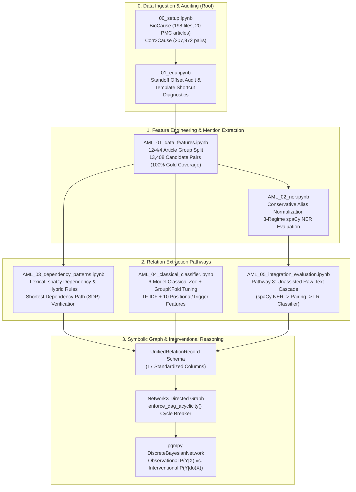
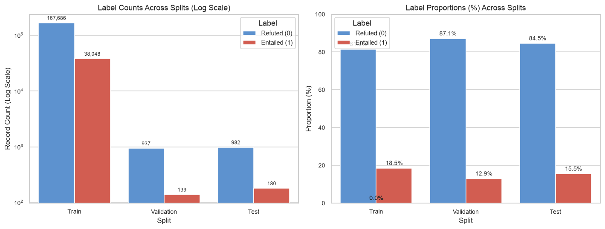
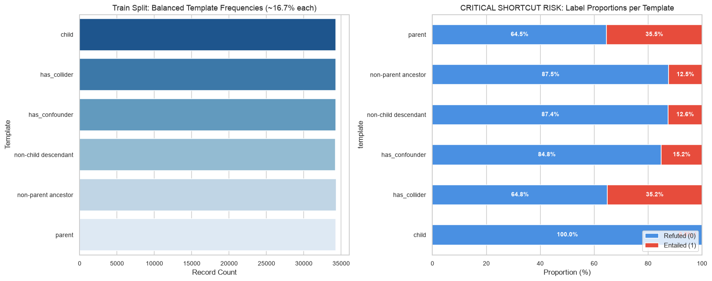
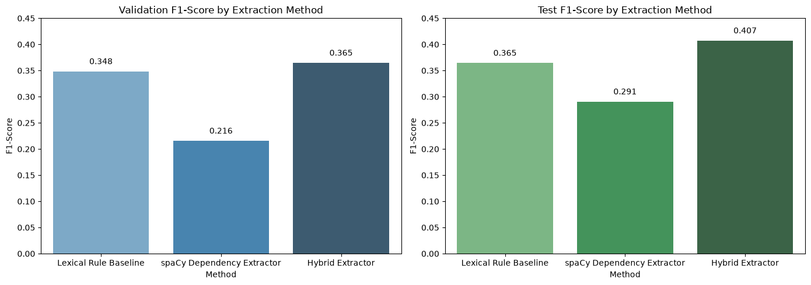
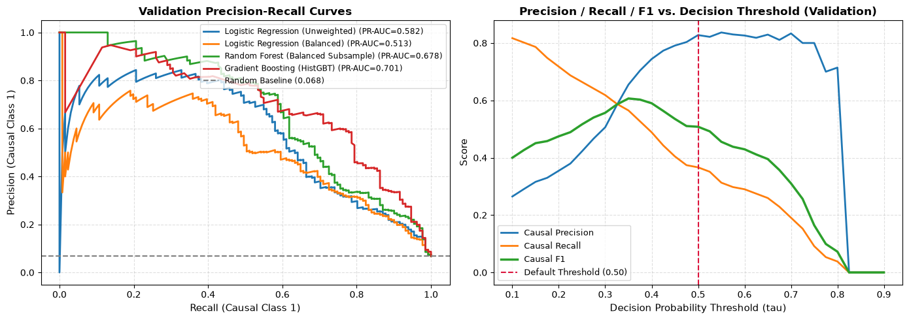
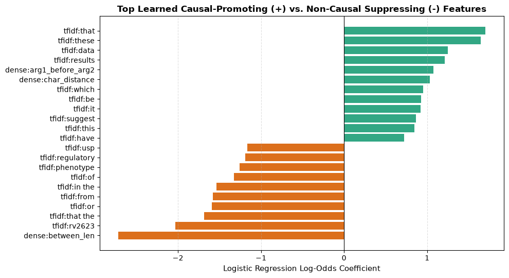
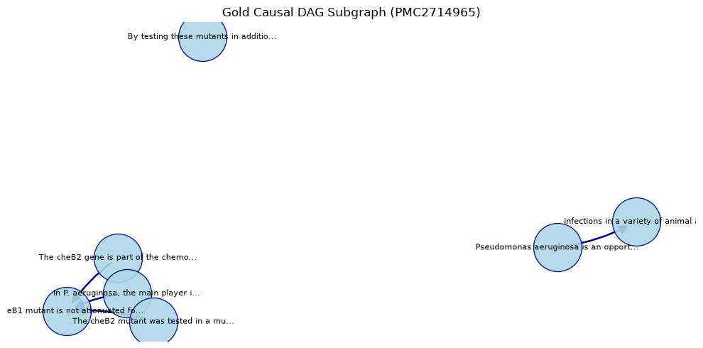
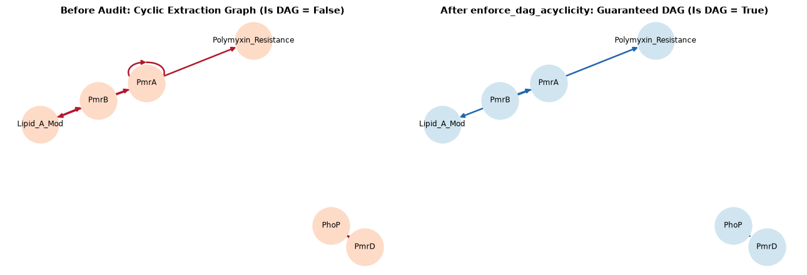
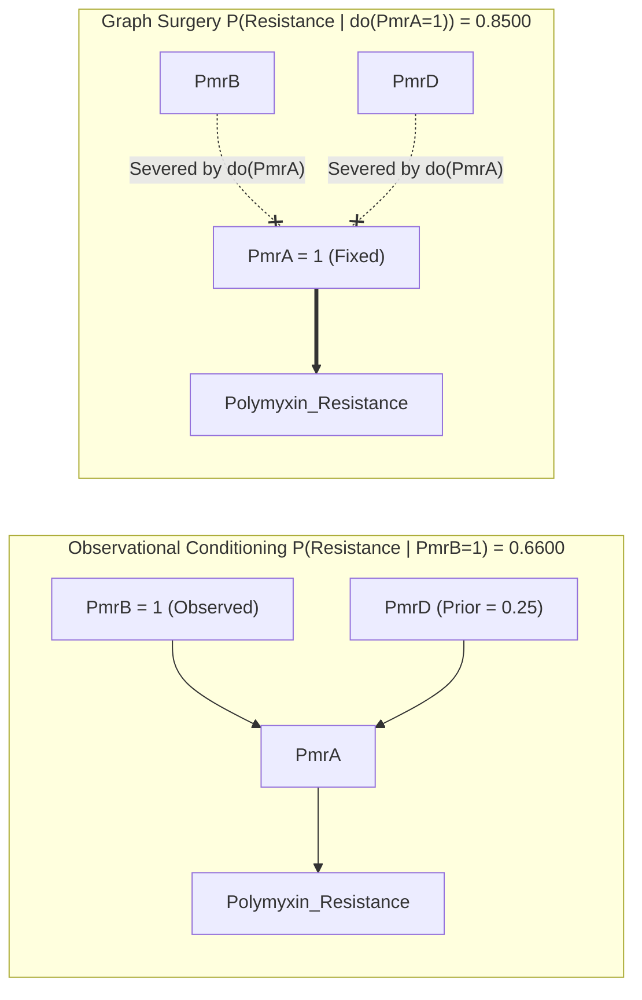
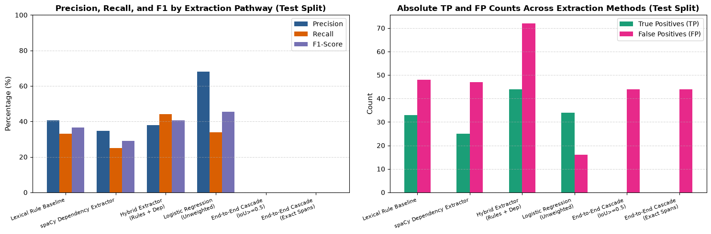

# Phase 1: Applied Machine Learning (AML) — Causal NLP & Bayesian Network Pipeline

This folder contains the complete **Phase 1 Applied Machine Learning** implementation for **Project 1: Neuro-Symbolic Causal Inference via Language Model Knowledge Extraction and Bayesian Networks**.

It bridges unstructured biomedical literature and formal causal inference through five sequential, fully executed notebooks (`AML_01` $\to$ `AML_05`), a shared direction-aware extraction library ([`causal_extractors.py`](causal_extractors.py)), and a 16-test automated verification suite ([`../tests/test_phase1_baseline.py`](../tests/test_phase1_baseline.py)).

---

## 1. End-to-End AML Architecture

---

## 2. Literature Review & Methodological Positioning

| Foundational Reference | Core Contribution | Role in Our Phase 1 AML Pipeline |
| :--- | :--- | :--- |
| **Pearl (1988, 2009)** — *Probabilistic Reasoning in Intelligent Systems* & *Causality* | Formalizes Directed Acyclic Graphs (DAGs), $d$-separation, Markov Equivalence Classes (MECs), and the $do$-calculus graph surgery operator $P(Y \mid do(X=x))$. | Grounds the neuro-symbolic bridge in [`AML_04`](AML_04_classical_classifier.ipynb) and [`AML_05`](AML_05_integration_evaluation.ipynb), contrasting observational association $P(\text{Resistance} \mid \text{PmrB})$ with interventional queries $P(\text{Resistance} \mid do(\text{PmrA}=1))$. |
| **Girju (2003); Rink et al. (2010)** — *Automatic Detection of Causal Relations in Text* | Introduces lexico-syntactic causal patterns (`<NP1, verb, NP2>`), passive voice direction inversion, negation pruning, and epistemic hedging controls. | Directly informs our direction-aware active/passive lexical rules, negation filtering, and correlation controls in [`causal_extractors.py`](causal_extractors.py) and [`AML_03`](AML_03_dependency_patterns.ipynb). |
| **Bunescu & Mooney (2005); Mintz et al. (2009)** — *Shortest Path Dependency Kernels & Distant Supervision* | Demonstrates that the Shortest Dependency Path (SDP) between entity heads in a syntactic parse tree concentrates core relational predicates. | Implemented via `compute_shortest_dependency_path` in [`causal_extractors.py`](causal_extractors.py) and evaluated alongside positional/TF-IDF features in [`AML_03`](AML_03_dependency_patterns.ipynb) and [`AML_04`](AML_04_classical_classifier.ipynb). |
| **Mihăilă et al. (2013)** — *BioCause: Annotating and Analysing Causality in the Biomedical Domain* | Provides 851 expert-annotated biomedical causal events (852 directed triples) across 20 full-text open-access PMC infectious disease articles. | Serves as our primary relation extraction corpus with strict 12/4/4 article-level group splitting (`train ∩ val == ∅`, `train ∩ test == ∅`). |
| **Jin et al. (2024)** — *Corr2Cause: Can Large Language Models Infer Causation from Correlation?* | Establishes a 207,972-pair benchmark testing whether formal causal hypotheses follow from statistical correlations and conditional independencies. | Audited in [`../01_eda.ipynb`](../01_eda.ipynb) for template prior shortcuts and benchmarked with 19 structural features in [`AML_01`](AML_01_data_features.ipynb) and [`AML_04`](AML_04_classical_classifier.ipynb). |

---

## 3. Dataset Architecture & Exploratory Diagnostics (`00_setup` & `01_eda`)

### 3.1 Primary Corpus: BioCause (Article-Isolated Partitioning)
To prevent document-level vocabulary and domain leakage, all 198 paired `.txt`/`.ann` section files are partitioned strictly by source publication (`article_id`, seed 42):

| Dataset Partition | PMC Articles | Section Files (Raw) | Sections with Candidates | Gold Relations | Candidate Pairs ($\le 2000$ chars) | Causal Prevalence (%) |
| :--- | :---: | :---: | :---: | :---: | :---: | :---: |
| **Train Split** | 12 | 130 | 121 | 621 | 10,086 | 6.16% |
| **Validation Split** | 4 | 33 | 33 | 131 | 1,914 | 6.84% |
| **Held-Out Test Split** | 4 | 35 | 31 | 100 | 1,408 | 7.10% |
| **Total BioCause** | **20** | **198** | **185** | **852** | **13,408** | **6.35%** |

### 3.2 Supplementary Benchmark: Corr2Cause Class Imbalance & Shortcut Audit
In [`../01_eda.ipynb`](../01_eda.ipynb), exploratory diagnostics reveal two critical properties of the Corr2Cause benchmark:
1. **Severe Class Imbalance**: Refuted (`0`) examples account for **81.51%** of Train, **87.08%** of Validation, and **84.77%** of Test splits.
2. **Template Shortcut Hazard**: The `child` hypothesis template has a **0.00% positive rate** (100% negative prior) across all splits, demonstrating why superficial accuracy without per-class F1 is misleading.

---

## 4. Module-by-Module Technical Breakdown

### 4.1 `AML_01_data_features.ipynb` — Standoff Parsing, Leak-Free Splitting & Feature Engineering
- Verifies **100% character-offset alignment** across all 12,939 annotated spans with `0` discontinuous spans and `0` broken references.
- Resolves branching causal events (`E36` in `PMC2242835-02-Results-06` with `Cause`, `Effect`, `Effect2` $\to$ 2 directed triples, totaling **852 gold causal relations**).
- Generates **13,408 ordered candidate pairs** within a 2,000-character window, achieving **100.00% coverage** (`852/852`) of gold relations while rejecting self-loops.
- Engineers **19 leak-free structural/linguistic features** for Corr2Cause (`n_correlations`, `n_independences`, `n_given_clauses`, `variable_overlap`, `indep_corr_ratio`, etc.).

---

### 4.2 `AML_02_ner.ipynb` — Scientific Mention Extraction & Alias Normalization
- Implements deterministic **conservative canonicalization** mapping known biological synonyms (`polymyxin b` $\to$ `POLYMYXIN_B`, `s. typhimurium` $\to$ `SALMONELLA_TYPHIMURIUM`) while preventing edit-distance conflation of distinct regulators (`PmrA` vs. `PmrB` vs. `PmrD`).
- Benchmarks general-purpose `en_core_web_sm` NER across three explicit matching regimes:

| Evaluation Regime | Target Scope | Validation Precision | Validation Recall | Validation F1 | Test Precision | Test Recall | Test F1 |
| :--- | :--- | :---: | :---: | :---: | :---: | :---: | :---: |
| **1. Span-Only Exact** | Conventional Entities | 26.50% | 17.27% | **20.91%** | 15.98% | 11.59% | **13.43%** |
| **1. Span-Only Exact** | All BioCause Spans | 26.72% | 10.81% | **15.39%** | 15.98% | 7.99% | **10.66%** |
| **2. Typed Exact** | Conventional Entities | 22.39% | 14.60% | **17.67%** | 10.35% | 7.51% | **8.70%** |
| **3. Max Relaxed ($\text{IoU}\ge 0.5$)** | Conventional Entities | 29.16% | 19.00% | **23.01%** | 18.29% | 13.27% | **15.38%** |
| **3. Max Relaxed ($\text{IoU}\ge 0.5$)** | All BioCause Spans | 29.71% | 12.02% | **17.11%** | 18.29% | 9.15% | **12.20%** |

---

### 4.3 `AML_03_dependency_patterns.ipynb` — Directional Rules, Dependency Trees & SDP Analysis
- Centralizes extraction logic in [`causal_extractors.py`](causal_extractors.py):
  - **Active vs. Passive Direction Normalization**: Distinguishes active forward syntax (`[Cause] activates / induces / leads to [Effect]`) from passive/inverted constructions (`[Effect] is caused by / results from / is mediated by [Cause]`).
  - **Linguistic Negative Controls**: Prunes negated predicates (`does not cause`, `failed to induce`, `dep_ == "neg"`), rejects correlational statements (`correlated with`, `associated with`), and down-weights epistemic hedging (`may`, `might`, `suggests` $\to \text{confidence}=0.70$).
  - **Shortest Dependency Path (SDP) Verification (`compute_shortest_dependency_path`)**: Constructs an undirected token graph over spaCy dependency arcs and verifies whether a causal predicate lemma lies on the shortest syntactic path connecting the candidate argument heads:

| Construction Type | Candidate Cause (`Arg1`) | Candidate Effect (`Arg2`) | SDP Hops | Extracted Shortest Dependency Path | Dependency Arc Labels | Causal Verb on SDP |
| :--- | :--- | :--- | :---: | :--- | :--- | :---: |
| **Active Verbal** | `PmrB kinase` | `PmrA response regulator` | `2` | `kinase -> activates -> PmrA` | `nsubj -> ROOT -> prt` | `True` |
| **Passive Verbal** | `PmrB phosphorylation` | `Resistance to polymyxin` | `3` | `Resistance -> caused -> by -> PmrB` | `nsubjpass -> ROOT -> agent -> pobj` | `True` |
| **Prepositional Result** | `PmrB mutation` | `bacterial lysis` | `3` | `lysis -> results -> from -> PmrB` | `compound -> ROOT -> prep -> pobj` | `True` |
| **Non-Causal Control** | `GeneA` | `GeneB` | `3` | `GeneA -> measured -> alongside -> GeneB` | `nsubjpass -> ROOT -> prep -> pobj` | `False` |

---

### 4.4 `AML_04_classical_classifier.ipynb` — Supervised Model Zoo, Tuning & Causal Bayesian Networks

#### A. Six-Model Classical Validation Comparison
Features (`StandardScaler` over 10 positional/length/trigger features + 100-feature 1–2 gram `TfidfVectorizer`) are fitted **strictly on `X_train` (`10,086` rows)** and evaluated across 6 classical model families on the validation split (`1,914` rows):

| Model Family | Val Accuracy | Val Macro-F1 | Causal Precision (1) | Causal Recall (1) | Causal F1 (1) | Val PR-AUC | Non-Causal F1 (0) |
| :--- | :---: | :---: | :---: | :---: | :---: | :---: | :---: |
| **Logistic Regression (Unweighted)** ⭐ | **0.9514** | **0.7412** | **0.8276** | 0.3664 | **0.5079** | 0.5820 | **0.9744** |
| **Gradient Boosting (`HistGBT`)** | 0.9509 | 0.7397 | 0.8136 | 0.3664 | 0.5053 | **0.7011** | 0.9742 |
| **Random Forest (Balanced Subsample)** | 0.8386 | 0.6643 | 0.2797 | 0.8626 | 0.4224 | 0.6781 | 0.9062 |
| **Logistic Regression (Balanced)** | 0.7795 | 0.6118 | 0.2229 | 0.8931 | 0.3567 | 0.5126 | 0.8670 |
| **LinearSVC (Balanced)** | 0.7732 | 0.6074 | 0.2189 | **0.9008** | 0.3522 | 0.4743 | 0.8626 |
| **Dummy (Majority)** | 0.9316 | 0.4823 | 0.0000 | 0.0000 | 0.0000 | 0.0684 | 0.9646 |

- **Why Unweighted Logistic Regression Wins for Graph Construction**: Class-balanced models inflate false positives (`Precision ~22–28%`), injecting dozens of spurious edges into downstream DAGs. `Logistic Regression (Unweighted)` achieves the highest **Validation Macro-F1 (`0.7412`)**, **Causal F1 (`0.5079`)**, and **Precision (`82.76%`)**.
- **Group-Aware Regularization Tuning (`GroupKFold` by `article_id`)**: 4-fold cross-validation across the 12 training articles confirms $C=1.0$ achieves optimal validation Macro-F1 (`0.7412`) without overfitting article-specific vocabulary.

#### B. Frozen Held-Out Test Evaluation & Bootstrap 95% Confidence Intervals
Evaluated once on the held-out test split (`1,408` candidates across 4 unseen PMC articles; `100` gold causal relations):
- **Confusion Matrix**: $\text{TN} = 1,292$, $\text{FP} = 16$, $\text{FN} = 66$, $\text{TP} = 34$ (Sum $= 1,408$).

| Held-Out Test Metric | Point Estimate | 1,000-Sample Bootstrap 95% CI |
| :--- | :---: | :---: |
| **Test Accuracy** | **94.18%** | — |
| **Test Macro-F1** | **0.7113** | `[0.6577, 0.7631]` |
| **Causal Precision (1)** | **68.00%** | `[54.17%, 80.50%]` |
| **Causal Recall (1)** | **34.00%** | `[24.51%, 43.48%]` |
| **Causal F1-Score (1)** | **45.33%** | `[34.78%, 55.35%]` |

#### C. NetworkX DAG Compilation & Deterministic Cycle-Breaking Proof (`enforce_dag_acyclicity`)
- **Graph Evaluation (`PMC2714965` Case Study vs. Corpus-Wide Test Partition)**:
  - **Case Study (`PMC2714965`)**: `6` predicted edges, `22` gold edges $\to$ **Edge Precision = 100.00% (6/6)**, **Recall = 27.27%**, **F1 = 42.86%**, `Is Acyclic = True`.
  - **Corpus-Wide (All 4 Test Articles)**: `50` predicted edges, `100` gold edges $\to$ **Edge Precision = 68.00% (34/50)**, **Recall = 34.00%**, **F1 = 45.33%**, `Is Acyclic = True`.
- **Deterministic Cycle-Breaking Engine (`enforce_dag_acyclicity`)**: Proves that even when noisy extractions introduce self-loops (`PmrA -> PmrA`), bidirectional conflicts (`PhoP <-> PmrD`), or 3-node feedback loops (`PmrB -> PmrA -> Lipid_A_Mod -> PmrB`), the cycle breaker deterministically prunes the lowest-confidence feedback edges to guarantee a valid DAG for `pgmpy`:

#### D. Probabilistic Bayesian Network & Pearl's $do$-Calculus (`pgmpy`)

- **Baseline Marginal**: $P(\text{Polymyxin\_Resistance} = 1) = \mathbf{0.3590}$
- **Observational Conditioning**: $P(\text{Polymyxin\_Resistance} = 1 \mid \text{PmrB} = 1) = \mathbf{0.6600}$ (`+0.3010` associative shift)
- **Interventional Query (`model.do(['PmrA'])`)**: $P(\text{Polymyxin\_Resistance} = 1 \mid do(\text{PmrA} = 1)) = \mathbf{0.8500}$ (pure causal effect via mutilated graph surgery)

---

## 5. `AML_05_integration_evaluation.ipynb` — Multi-Pathway Benchmark

Integrates all extraction methodologies under a strict 17-column `UnifiedRelationRecord` schema on the held-out test split (`100` gold causal relations):

| Pathway & Extraction Method | Conditioning Regime | Pred Count | TP | FP | FN | Precision (%) | Recall (%) | F1-Score (%) |
| :--- | :--- | :---: | :---: | :---: | :---: | :---: | :---: | :---: |
| **Pathway 1: Lexical Rule Baseline** | Gold Argument Spans | 81 | 33 | 48 | 67 | 40.74% | 33.00% | **36.46%** |
| **Pathway 1: spaCy Dependency Extractor** | Gold Argument Spans | 72 | 25 | 47 | 75 | 34.72% | 25.00% | **29.07%** |
| **Pathway 1: Hybrid Extractor (Rules + Dep)** | Gold Argument Spans | 116 | 44 | 72 | 56 | 37.93% | **44.00%** | **40.74%** |
| **Pathway 2: Logistic Regression (Unweighted)** ⭐ | Gold Argument Spans | 50 | 34 | 16 | 66 | **68.00%** | 34.00% | **45.33%** |
| **Pathway 3: End-to-End Cascade ($\text{IoU}\ge 0.5$)** | Raw Text (`en_core_web_sm`) | 44 | 0 | 44 | 100 | 0.00% | 0.00% | **0.00%** |

> **Key Architectural Insight Indicating Phase 2 (DL)**: While supervised feature engineering boosts precision to **68.00%** on gold spans (Pathway 2), unassisted raw-text extraction (Pathway 3) collapses to **0.00% F1** because general-domain `en_core_web_sm` misses complex biomedical event clauses (12.20% relaxed NER F1 in `AML_02`). This directly motivates fine-tuning domain-specific transformers (BioBERT / PubMedBERT / DistilBERT) in [`../DL/`](../DL/).
