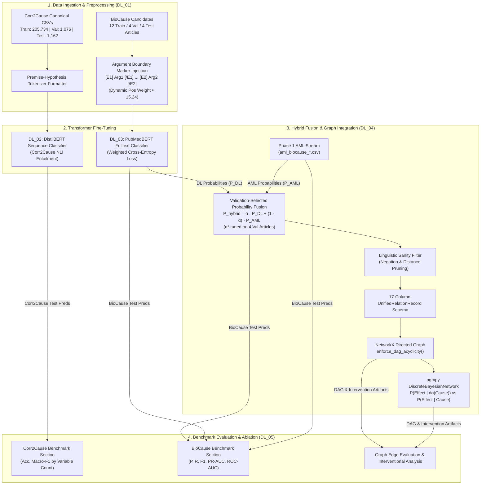

# Phase 2: Deep Learning & Hybrid Neuro-Symbolic Integration

This directory contains the Phase 2 (Deep Learning) architecture and pipeline structure for the **Causal NLP Reasoning** project.

Phase 2 advances beyond Phase 1's classical machine learning extractors by fine-tuning compact transformer architectures (**DistilBERT** and **PubMedBERT Fulltext**), ensembling deep contextual representations with syntactic/lexical features via validation-tuned probability fusion, and maintaining strict schema compatibility with downstream symbolic causal graphs (**NetworkX DAGs**) and interventional Bayesian networks (**`pgmpy`**).

---

## 1. Phase 2 Objectives

1. **Abstract Causal Entailment**: Fine-tune a compact transformer (**DistilBERT**) on **Corr2Cause** to evaluate deductive causal graph reasoning from natural language statistical independence statements.
2. **Biomedical Causal Relation Classification**: Fine-tune a domain-pretrained transformer (**PubMedBERT Fulltext**) on **BioCause** using explicit argument boundary markers (`[E1]...[/E1]` and `[E2]...[/E2]`) and dynamic loss weighting to classify directed cause-effect links under severe class imbalance.
3. **Validation-Tuned Hybrid Ensembling**: Integrate Phase 1 classical predictions (Logistic Regression, HistGBT, Shortest Dependency Path) with Phase 2 deep learning predictions via linear probability fusion ($P_{\text{hybrid}} = \alpha \cdot P_{\text{DL}} + (1 - \alpha) \cdot P_{\text{AML}}$), where the fusion parameter $\alpha \in [0, 1]$ and classification threshold $\tau$ are calibrated exclusively on held-out validation articles.
4. **Symbolic Integration & Deterministic Cycle Breaking**: Preserve 100% compliance with the standardized 17-column `UnifiedRelationRecord` schema, reusing Phase 1 NetworkX graph utilities for cycle pruning (`enforce_dag_acyclicity`) and compiling acyclic DAGs into `pgmpy` Bayesian networks for Pearl's $do$-calculus interventional queries.
5. **Rigorous Comparative Benchmarking**: Evaluate on identical held-out test splits to quantify whether deep learning and hybrid architectures surpass Phase 1 classical baselines.

---

## 2. Overall Architecture



---

## 3. Strict Boundary: Corr2Cause vs. BioCause

A fundamental architectural constraint of this repository is the complete operational and conceptual separation between the two datasets:

| Dimension | Corr2Cause | BioCause |
| :--- | :--- | :--- |
| **Domain** | Abstract propositional causal inference | Applied biomedical literature (PubMed Central) |
| **Task Formulation** | Natural Language Inference (Premise $\to$ Hypothesis) | Candidate-conditioned directed relation classification |
| **Input Representation** | `Premise: ... Hypothesis: ...` | Sentence context with markers: `[E1] Arg1 [/E1] ... [E2] Arg2 [/E2]` |
| **Target Labels** | Binary: `1` (Entailed), `0` (Refuted) | Binary: `1` (Arg1 causes Arg2), `0` (Arg1 does not cause Arg2) |
| **Canonical Split Distribution** | Train: 205,734 \| Val: 1,076 \| Test: 1,162 | **Article-level grouping**: 12 train (10,086 cands) \| 4 val (1,914 cands) \| 4 test (1,408 cands) |
| **Downstream Graph** | **Does NOT feed into knowledge graph** | **Feeds directly into NetworkX DAG and pgmpy BN** |
| **Evaluation Scope** | Standalone benchmark table (Macro-F1, Accuracy) | Standalone relation & graph edge benchmark table (P, R, F1) |

> **Critical Boundary Rule**: Corr2Cause predictions must never be mixed with BioCause predictions, and Corr2Cause outputs must never feed into the BioCause knowledge graph.

---

## 4. Technical Scope of Notebooks

| Notebook | Scope & Core Technical Responsibilities |
| :--- | :--- |
| **`DL_01_data_preparation.ipynb`** | Ingest canonical raw datasets; audit 12/4/4 article-level split isolation (zero cross-split leakage); inject argument boundary markers (`[E1]`, `[/E1]`, `[E2]`, `[/E2]`); compute training dynamic class weight ($w_{\text{pos}} = 9,465 / 621 \approx 15.24$); profile token lengths; serialize model-ready splits. |
| **`DL_02_corr2cause_distilbert.ipynb`** | Fine-tune `distilbert-base-uncased` for Corr2Cause binary causal entailment; format `[CLS] Premise [SEP] Hypothesis [SEP]`; AdamW optimization with FP16; checkpoint selection on validation split; export test predictions. |
| **`DL_03_biocause_pubmedbert.ipynb`** | Fine-tune `microsoft/BiomedNLP-BiomedBERT-base-uncased-abstract-fulltext` for BioCause directed relation classification; resize embeddings for special boundary tokens; apply dynamic class-weighted loss; tune classification threshold on validation articles; export test probabilities. |
| **`DL_04_hybrid_graph_integration.ipynb`** | Ingest AML and PubMedBERT streams; grid-search validation-optimal fusion weight $\alpha^* \in [0, 1]$ and threshold $\tau^*$; apply linguistic negation filtering; format positive predictions into 17-column `UnifiedRelationRecord` schema; compile NetworkX DAG with `enforce_dag_acyclicity`; execute `pgmpy` Bayesian network interventional queries. |
| **`DL_05_evaluation_ablation.ipynb`** | Comparative benchmarking (AML vs. DL vs. Hybrid); evaluate separate Corr2Cause and BioCause sections; execute 4-dimensional ablation studies; evaluate graph edge precision/recall/F1 against gold BioCause relations; generate final summary tables and figures in `reports/`. |

---

## 5. Pipeline Execution Order & Data Contracts

Notebooks are designed to execute sequentially from `DL_01` to `DL_05`:

```text
DL_01_data_preparation.ipynb
        │
        ├──► DL_02_corr2cause_distilbert.ipynb ──┐
        │                                        │
        └──► DL_03_biocause_pubmedbert.ipynb     │
                     │                           │
                     ▼                           │
             DL_04_hybrid_graph_integration.ipynb │
                     │                           │
                     ▼                           ▼
             DL_05_evaluation_ablation.ipynb ◄───┘
```

### Input and Output Artifact Contracts

```
[DL_01: Data Preparation]
  Inputs:
    - data/raw/train.csv, validation.csv, test.csv (Canonical Corr2Cause: 205,734 / 1,076 / 1,162)
    - data/processed/biocause_candidates.csv (BioCause candidates: 10,086 train / 1,914 val / 1,408 test)
    - data/processed/biocause_relations.csv (Gold relations: 852 total, 100 test)
  Outputs:
    - data/processed/dl_corr2cause_{train,val,test}.csv
    - data/processed/dl_biocause_{train,val,test}.csv (with [E1]...[E2] markers)

[DL_02: Corr2Cause DistilBERT]
  Inputs:
    - data/processed/dl_corr2cause_{train,val,test}.csv
  Outputs:
    - DL/checkpoints/corr2cause_distilbert/ (best model weights)
    - data/processed/dl_corr2cause_test_predictions.csv (columns: index, true_label, pred_label, prob_entailed, num_variables)

[DL_03: BioCause PubMedBERT]
  Inputs:
    - data/processed/dl_biocause_{train,val,test}.csv
  Outputs:
    - DL/checkpoints/biocause_pubmedbert/ (best model weights)
    - data/processed/dl_biocause_validation_predictions.csv (1,914 rows; columns: candidate_id, article_id, section_id, arg1_id, arg2_id, true_label, dl_prob, dl_pred, split)
    - data/processed/dl_biocause_test_predictions.csv (1,408 rows; columns: candidate_id, article_id, section_id, arg1_id, arg2_id, true_label, dl_prob, dl_pred, split)

[DL_04: Hybrid Integration & Graph Compilation]
  Inputs:
    - data/processed/aml_biocause_validation_predictions.csv (Phase 1 AML prerequisite, 1,914 rows)
    - data/processed/aml_biocause_test_predictions.csv (Phase 1 AML prerequisite, 1,408 rows)
    - data/processed/dl_biocause_validation_predictions.csv (from DL_03, 1,914 rows)
    - data/processed/dl_biocause_test_predictions.csv (from DL_03, 1,408 rows)
  Outputs:
    - data/processed/dl_biocause_hybrid_predictions.csv (17-column UnifiedRelationRecord schema)
    - Verified acyclic NetworkX DAG and pgmpy Bayesian Network

[DL_05: Comprehensive Evaluation & Ablations]
  Inputs:
    - data/processed/dl_corr2cause_test_predictions.csv (from DL_02)
    - data/processed/dl_biocause_test_predictions.csv (from DL_03)
    - data/processed/dl_biocause_hybrid_predictions.csv (from DL_04)
    - data/processed/biocause_relations.csv (Gold 100 test relations)
  Outputs:
    - reports/dl_final_benchmark_summary.csv
    - reports/dl_ablation_summary.csv
    - High-resolution evaluation figures (PR curves, ROC curves, calibration plots)
```

---

## 6. AML Prediction Export Prerequisite

`DL_04_hybrid_graph_integration.ipynb` requires candidate-aligned AML prediction files:
- `data/processed/aml_biocause_validation_predictions.csv` (1,914 rows)
- `data/processed/aml_biocause_test_predictions.csv` (1,408 rows)

Required columns:
```text
candidate_id, true_label, aml_prob, aml_pred, split
```

### Primary AML Baseline Model
The primary classical classifier designated as the input stream for hybrid integration is **`Logistic Regression (Moderate Weight 1:2)`**, which achieved the highest Phase 1 validation F1 score (55.32% F1 on test). Alternative AML models (such as `Logistic Regression (Unweighted)`, `HistGBT`, and `Random Forest`) are preserved and reported as separate comparative baselines.

### Reproducible Generation from Phase 1
The AML classifier is fitted strictly on the training partition ($N = 10,086$) and evaluated to generate held-out validation predictions ($N = 1,914$) and test predictions ($N = 1,408$). If these files are not present in `data/processed/`, they are produced by executing the unchanged Phase 1 classifier pipeline from `AML/AML_04_classical_classifier.ipynb`:
1. Load `data/processed/biocause_candidates.csv`.
2. Extract the identical 10 structural/lexical features and 100 TF-IDF n-grams fitted strictly on the training split.
3. Fit the primary classifier (`Logistic Regression (Moderate Weight 1:2)`).
4. Predict probabilities using `predict_proba()` on held-out validation candidates (1,914 rows) and test candidates (1,408 rows).
5. Export with candidate keys (`candidate_id`) to ensure 100% alignment with deep learning predictions.

---

## 7. BioCause Label Semantics & Class Imbalance

### Directional Candidate Semantics
The BioCause candidate generation pipeline extracts every co-occurring entity pair $(Arg_1, Arg_2)$ within sentences:
- **Label `1`**: Directed causal relation $Arg_1 \to Arg_2$ is annotated in the gold corpus.
- **Label `0`**: $Arg_1$ does not represent the gold directed relation $Arg_1 \to Arg_2$. **Important**: Label `0` candidates include reversed directional pairs $(Arg_2, Arg_1)$ where causality runs in the opposite direction, as well as pairs with no causal connection. Label `0` must not be mischaracterized as universally non-causal.

### Dynamic Class Imbalance Mitigation
The candidate generation process results in severe class imbalance:
- **Train split**: 621 positive / 9,465 negative = **15.24:1 negative-to-positive ratio**.
- **Validation split**: 131 positive / 1,783 negative = **13.61:1 ratio**.
- **Test split**: 100 positive / 1,308 negative = **13.08:1 ratio**.

To prevent the model from collapsing to the majority negative class, positive class loss weights must be computed dynamically strictly from training data:
$$\text{pos\_weight} = \frac{N_{\text{train, neg}}}{N_{\text{train, pos}}} = \frac{9465}{621} \approx 15.2415$$
Weights must **never** be derived using validation or test split labels.

---

## 8. Hybrid Validation Discipline & Graph Integration

### Validation Discipline
Linear probability-score fusion combines model estimates:
$$P_{\text{hybrid}} = \alpha \cdot P_{\text{DL}} + (1 - \alpha) \cdot P_{\text{AML}}$$
- The blending parameter $\alpha \in [0, 1]$ and decision threshold $\tau$ are selected by sweeping $\alpha$ with step 0.05 strictly on the held-out validation articles (1,914 candidate pairs).
- Test set predictions are evaluated **exactly once** using the frozen validation-selected $\alpha^*$ and $\tau^*$.
- Probability-score fusion is empirically compared against both pure AML ($\alpha = 0$) and pure DL ($\alpha = 1$) baselines.

> **Note**: Raw model probability outputs are not calibrated probabilities unless an explicit calibration method (e.g., Platt scaling, isotonic regression) is applied. The fusion formula operates on raw predicted scores.

### Graph & Bayesian Network Reasoning
1. **17-Column Schema**: Positive relations are formatted into `UNIFIED_RELATION_SCHEMA` (`relation_id`, `article_id`, `section_id`, `cause_id`, `cause_text`, `cause_start`, `cause_end`, `effect_id`, `effect_text`, `effect_start`, `effect_end`, `direction`, `confidence`, `extraction_method`, `evidence_text`, `provenance`, `split`).
2. **Deterministic Cycle Breaking**: Extracted edges are processed via `enforce_dag_acyclicity()` from `AML/causal_extractors.py`, which logs and prunes self-loops, resolves bidirectional conflicts, and breaks feedback cycles.
3. **Causal Interpretation Guardrail**: An acyclic graph is a mathematical topological property, not an absolute guarantee of causal ground truth. Cycle breaking enforces formal mathematical consistency required for Bayesian inference.
4. **Bayesian Network Intervention**: Compiles acyclic DAGs into `pgmpy` `DiscreteBayesianNetwork` to illustrate observational distributions $P(Y \mid X)$ versus interventional distributions $P(Y \mid do(X))$.

---

## 9. Systematic Ablation Study Plan

The evaluation pipeline in `DL_05` executes four core ablation studies:

| Ablation Study | Experimental Configurations | Evaluation Metric | Research Question |
| :--- | :--- | :--- | :--- |
| **1. Argument Boundary Markers** | Marked (`[E1]...[E2]`) vs. Unmarked text | Precision, Recall, F1 | Do explicit positional tokens improve bidirectional attention across entity arguments? |
| **2. Dynamic Loss Weighting** | Weighted ($w_{\text{pos}} \approx 15.24$) vs. Unweighted ($w=1.0$) | Causal Recall, PR-AUC | Does dynamic weighting prevent minority class suppression under 15.24:1 imbalance? |
| **3. Ensembling Paradigm** | Pure AML ($\alpha=0$) vs. Pure DL ($\alpha=1$) vs. Hybrid ($\alpha^*$) | F1, Macro-F1, ROC-AUC | Does combining syntactic/lexical rules with contextual transformers outperform single models? |
| **4. Linguistic Post-Processing** | Hybrid with vs. without negation/distance filters | Edge Precision, False Positives | Does symbolic post-filtering effectively remove false positive causal edges? |

---

## 10. Free Kaggle GPU & Google Colab Execution Workflow

Both transformer models (`distilbert-base-uncased` and `microsoft/BiomedNLP-BiomedBERT-base-uncased-abstract-fulltext`) are compact architectures designed to train comfortably within **free Kaggle (NVIDIA T4 x 2)** or **Google Colab (T4)** environments:

### Kaggle Environment Setup
1. **Accelerator**: Select **GPU T4 x 2** or **GPU T4**.
2. **Internet**: Toggle **Internet ON** in notebook settings to download pretrained transformer checkpoints.
3. **Pre-installed PyTorch**: Kaggle provides pre-installed PyTorch with CUDA acceleration. **Do not run `pip install torch`** as it can downgrade or conflict with the CUDA runtime.
4. **Install Phase 2 Requirements**:
   ```bash
   pip install -r requirements-dl.txt
   ```
5. **Memory and Quota Management (Conservative Initial Defaults)**:
   - BioCause batch size: 8 (with gradient accumulation: 2).
   - DistilBERT batch size: 16.
   - Mixed precision: enable `fp16=True` only when CUDA is available (do not enable on CPU or MPS).
   - Evaluation strategy: use modern `eval_strategy="epoch"` (replacing legacy `evaluation_strategy`).
   - Set `save_total_limit=1` to prevent exhausting Kaggle's 20 GB disk quota with stale checkpoints.

### Google Colab Environment Setup
1. **Runtime Type**: Navigate to `Runtime` > `Change runtime type` > select **T4 GPU**.
2. **Clone & Install**:
   ```bash
   git clone https://github.com/alpha-sml/causal-nlp-reasoning.git
   cd causal-nlp-reasoning
   pip install -r requirements-dl.txt
   ```

---

## 11. Dependencies & Clean Architecture Policy

Phase 2 relies strictly on 10 essential open-source dependencies specified in `requirements-dl.txt`:

```text
torch>=2.2.0
transformers>=4.40.0
datasets>=2.19.0
accelerate>=0.30.0
scikit-learn>=1.4.0
pandas>=2.2.0
numpy>=1.26.0
matplotlib>=3.8.0
seaborn>=0.13.0
tqdm>=4.66.0
```

> **Clean Architecture Policy**: No paid external APIs, proprietary LLM endpoints, heavyweight vector databases (FAISS/Chroma), RAG frameworks (LangChain/LlamaIndex), or inference servers (vLLM) are used. The pipeline relies entirely on open-source, reproducible, local transformer fine-tuning.

---

## 12. Data Directory Expectations

### Required Raw Dataset Files

| File | Location | Source |
| :--- | :--- | :--- |
| `train.csv` | `data/raw/` | Corr2Cause (HuggingFace: `causalnlp/corr2cause`) |
| `validation.csv` | `data/raw/` | Corr2Cause |
| `test.csv` | `data/raw/` | Corr2Cause |
| `biocause_candidates.csv` | `data/processed/` | Generated by `00_setup.ipynb` + `AML/AML_01_data_features.ipynb` |
| `biocause_relations.csv` | `data/processed/` | Generated by `00_setup.ipynb` + `AML/AML_01_data_features.ipynb` |

### Expected Processed Outputs (from DL_01)

| File | Rows | Description |
| :--- | ---: | :--- |
| `dl_corr2cause_train.csv` | 205,734 | Corr2Cause training split |
| `dl_corr2cause_val.csv` | 1,076 | Corr2Cause validation split |
| `dl_corr2cause_test.csv` | 1,162 | Corr2Cause test split |
| `dl_biocause_train.csv` | 10,086 | BioCause training candidates with entity markers |
| `dl_biocause_val.csv` | 1,914 | BioCause validation candidates with entity markers |
| `dl_biocause_test.csv` | 1,408 | BioCause test candidates with entity markers |

---

## 13. How to Execute the Preparation Notebook

```bash
# 1. Install Phase 2 dependencies (skip torch if pre-installed on Kaggle/Colab)
pip install -r requirements-dl.txt

# 2. Ensure raw datasets are staged
#    Run 00_setup.ipynb if data/raw/ and data/processed/ are empty

# 3. Execute the data preparation notebook
jupyter nbconvert --to notebook --execute DL/DL_01_data_preparation.ipynb

# 4. Run Phase 2 tests
python -m pytest tests/test_dl_utils.py -v
```

---

## 14. Shared Utility Descriptions (`DL/dl_utils.py`)

| Function | Description |
| :--- | :--- |
| `find_repo_root()` | Locate repository root across local, Colab, and Kaggle environments |
| `setup_repo_imports()` | Configure `sys.path` with repo root and subdirectories |
| `set_seed(seed)` | Set random seeds for Python, NumPy, and PyTorch (CPU/GPU) |
| `get_device()` | Detect CUDA, Apple MPS, or CPU with safe fallback |
| `validate_dataset_schema(df, cols)` | Validate DataFrame or HuggingFace Dataset column presence |
| `validate_biocause_candidates(df)` | Extended BioCause validation: labels, duplicates, split isolation |
| `format_biocause_input_with_markers(...)` | Insert `[E1]`/`[/E1]`/`[E2]`/`[/E2]` markers with offset validation |
| `crop_context_around_entities(...)` | Context-crop long texts preserving all entity markers |
| `prepare_tokenizer_and_inputs(...)` | Load tokenizer and register special tokens |
| `calculate_dynamic_class_weight(neg, pos)` | Compute pos_weight = neg/pos from training counts only |
| `get_training_arguments(...)` | HuggingFace TrainingArguments factory with auto fp16 detection |
| `compute_classification_metrics(eval_pred)` | Accuracy, Precision, Recall, F1, Confusion Matrix |
| `fuse_probabilities(aml, dl, alpha)` | P_hybrid = α·P_DL + (1-α)·P_AML with validation |
| `export_predictions(df, path, fmt)` | Safe CSV/Parquet export with parent dir creation |
| `build_unified_relation_record(...)` | 17-column schema record with deterministic relation IDs |

---

## 15. Known Limitations and Assumptions

1. **Raw datasets must be pre-staged**: The notebook does not download datasets automatically. Run `00_setup.ipynb` first.
2. **Tokenizer download requires internet**: First execution needs internet access to download HuggingFace tokenizer weights. Subsequent runs use cached versions.
3. **No GPU required for data preparation**: `DL_01` runs on CPU. GPU is only needed for `DL_02` and `DL_03` training.
4. **Probability fusion operates on raw model scores**: The fusion formula $P_{\text{hybrid}} = \alpha \cdot P_{\text{DL}} + (1-\alpha) \cdot P_{\text{AML}}$ uses raw predicted probabilities. No calibration method is applied unless explicitly implemented.
5. **Article-level split is inherited**: The 12/4/4 article split is inherited from Phase 1 (`00_setup.ipynb` + `AML_01`). DL_01 validates but does not reassign splits.
