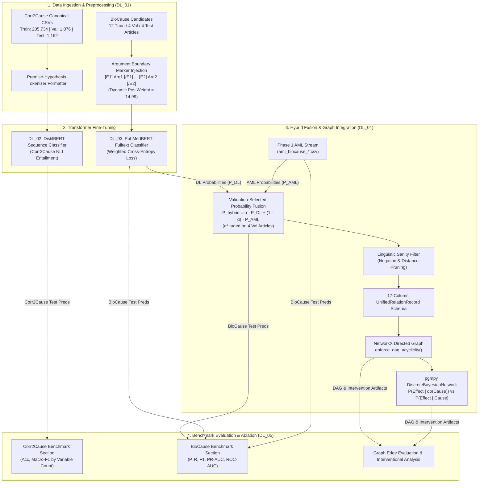

# Phase 2: Deep Learning & Hybrid Neuro-Symbolic Integration

This directory contains the Phase 2 (Deep Learning) architecture and pipeline structure for the **Causal NLP Reasoning** project.

Phase 2 advances beyond Phase 1's classical machine learning extractors by fine-tuning compact transformer architectures (**DistilBERT** and **PubMedBERT Fulltext**), ensembling deep contextual representations with syntactic/lexical features via validation-tuned probability fusion, and maintaining strict schema compatibility with downstream symbolic causal graphs (**NetworkX DAGs**) and interventional Bayesian networks (**`pgmpy`**).

---

## 1. Phase 2 Objectives

1. **Abstract Causal Entailment**: Fine-tune a compact transformer (**DistilBERT**) on **Corr2Cause** to evaluate deductive causal graph reasoning from natural language statistical independence statements.
2. **Biomedical Causal Relation Classification**: Fine-tune a domain-pretrained transformer (**PubMedBERT Fulltext**) on **BioCause** using explicit argument boundary markers (`[E1]...[/E1]` and `[E2]...[/E2]`) and dynamic loss weighting to classify directed cause-effect links under severe class imbalance.
3. **Validation-Tuned Hybrid Ensembling**: Integrate Phase 1 classical predictions (Logistic Regression, HistGBT, Shortest Dependency Path) with Phase 2 deep learning predictions via linear probability fusion ($P_{\text{hybrid}} = \alpha \cdot P_{\text{DL}} + (1 - \alpha) \cdot P_{\text{AML}}$), where the fusion parameter $\alpha \in [0, 1]$ and classification threshold $\tau$ are calibrated exclusively on held-out validation articles.
4. **Symbolic Integration & Deterministic Cycle Breaking**: Preserve 100% compliance with the standardized 17-column `UnifiedRelationRecord` schema, reusing Phase 1 NetworkX graph utilities for cycle pruning (`enforce_dag_acyclicity`) and compiling acyclic DAGs into `pgmpy` Bayesian networks for Pearl's $do$-calculus interventional queries.
5. **Rigorous Comparative Benchmarking**: Evaluate on identical held-out test splits to quantify whether deep learning and hybrid architectures surpass Phase 1 classical baselines.

---

## 2. Overall Architecture



---

## 3. Strict Boundary: Corr2Cause vs. BioCause

A fundamental architectural constraint of this repository is the complete operational and conceptual separation between the two datasets:

| Dimension | Corr2Cause | BioCause |
| :--- | :--- | :--- |
| **Domain** | Abstract propositional causal inference | Applied biomedical literature (PubMed Central) |
| **Task Formulation** | Natural Language Inference (Premise $\to$ Hypothesis) | Candidate-conditioned directed relation classification |
| **Input Representation** | `Premise: ... Hypothesis: ...` | Sentence context with markers: `[E1] Arg1 [/E1] ... [E2] Arg2 [/E2]` |
| **Target Labels** | Binary: `1` (Entailed), `0` (Refuted) | Binary: `1` (Arg1 causes Arg2), `0` (Arg1 does not cause Arg2) |
| **Canonical Split Distribution** | Train: 205,734 \| Val: 1,076 \| Test: 1,162 | **Article-level grouping (12 / 4 / 4 articles)**: Raw: 10,086 train / 1,914 val / 1,408 test \| Model-eligible: **9,928** train (`621` pos, `9,307` neg) \| **1,884** val (`131` pos, `1,753` neg) \| **1,394** test (`100` pos, `1,294` neg) |
| **Downstream Graph** | **Does NOT feed into knowledge graph** | **Feeds directly into NetworkX DAG and pgmpy BN** |
| **Evaluation Scope** | Standalone benchmark table (Macro-F1, Accuracy) | Standalone relation & graph edge benchmark table (P, R, F1) |

> **Critical Boundary Rule**: Corr2Cause predictions must never be mixed with BioCause predictions, and Corr2Cause outputs must never feed into the BioCause knowledge graph.

---

## 4. Technical Scope of Notebooks

| Notebook | Scope & Core Technical Responsibilities |
| :--- | :--- |
| **`DL_01_data_preparation.ipynb`** | Ingest canonical raw datasets; audit 12/4/4 article-level split isolation (zero cross-split leakage); inject argument boundary markers (`[E1]`, `[/E1]`, `[E2]`, `[/E2]`); compute training dynamic class weight ($w_{\text{pos}} = 9,307 / 621 \approx 14.9871$ from model-eligible candidates); profile token lengths; serialize model-ready splits. |
| **`DL_02_corr2cause_distilbert.ipynb`** | Fine-tune `distilbert-base-uncased` for Corr2Cause binary causal entailment; format `[CLS] Premise [SEP] Hypothesis [SEP]`; AdamW optimization with FP16; checkpoint selection on validation split; export test predictions. |
| **`DL_03_biocause_pubmedbert.ipynb`** | Fine-tune `microsoft/BiomedNLP-BiomedBERT-base-uncased-abstract-fulltext` for BioCause directed relation classification; resize embeddings for special boundary tokens; apply normalized dynamic class-weighted loss; perform joint validation `(epoch_checkpoint, threshold)` selection (`checkpoint-3723`, Epoch `3.0`, $\tau^* = 0.1600$); export validation/test probabilities and metrics; persist SafeTensors weights & tokenizer (with standalone Section 10 recovery/verification cell). |
| **`DL_04_hybrid_graph_integration.ipynb`** | Ingest AML and PubMedBERT streams; grid-search validation-optimal fusion weight $\alpha^* = 0.25$ and threshold $\tau^* = 0.4400$; apply linguistic negation filtering; format positive predictions into 17-column `UnifiedRelationRecord` schema; compile NetworkX DAG with `enforce_dag_acyclicity`; execute `pgmpy` Bayesian network interventional queries; serialize `aml_classifier.pkl` via Joblib and package `DL/models/hybrid_biocause/`. |
| **`DL_05_evaluation_ablation.ipynb`** | Comparative benchmarking (AML vs. DL vs. Hybrid); evaluate separate Corr2Cause and BioCause sections; execute 4-dimensional ablation studies with joint `(checkpoint, threshold)` validation selection; evaluate graph edge precision/recall/F1 against gold BioCause relations; export final summary tables and figures to `reports/`. |

---

## 5. Pipeline Execution Order & Data Contracts

Notebooks are designed to execute sequentially from `DL_01` to `DL_05`:

```text
DL_01_data_preparation.ipynb
        │
        ├──► DL_02_corr2cause_distilbert.ipynb ──┐
        │                                        │
        └──► DL_03_biocause_pubmedbert.ipynb     │
                     │                           │
                     ▼                           │
             DL_04_hybrid_graph_integration.ipynb │
                     │                           │
                     ▼                           ▼
             DL_05_evaluation_ablation.ipynb ◄───┘
```

### Input and Output Artifact Contracts

```
[DL_01: Data Preparation]
  Inputs:
    - data/raw/train.csv, validation.csv, test.csv (Canonical Corr2Cause: 205,734 / 1,076 / 1,162)
    - data/processed/biocause_candidates.csv (BioCause candidates: 10,086 train / 1,914 val / 1,408 test)
    - data/processed/biocause_relations.csv (Gold relations: 852 total, 100 test)
  Outputs:
    - data/processed/dl_corr2cause_{train,val,test}.csv
    - data/processed/dl_biocause_{train,val,test}.csv (with [E1]...[E2] markers)

[DL_02: Corr2Cause DistilBERT]
  Inputs:
    - data/processed/dl_corr2cause_{train,val,test}.csv
  Outputs:
    - DL/checkpoints/corr2cause_distilbert/ (best model weights)
    - data/processed/dl_corr2cause_test_predictions.csv (columns: index, true_label, pred_label, prob_entailed, num_variables)

[DL_03: BioCause PubMedBERT]
  Inputs:
    - data/processed/dl_biocause_{train,val,test}.csv
  Outputs:
    - DL/models/biocause_pubmedbert_best/ (validation-selected checkpoint & tokenizer)
    - DL/models/hybrid_biocause/pubmedbert/ (SafeTensors weights & tokenizer for hybrid bundle)
    - data/processed/dl_biocause_metrics.json (joint epoch & threshold selection metadata)
    - data/processed/dl_biocause_validation_predictions.csv (1,884 rows; columns: candidate_id, article_id, section_id, arg1_id, arg2_id, true_label, dl_prob, dl_pred, split, arg1_before_arg2)
    - data/processed/dl_biocause_test_predictions.csv (1,394 rows; columns: candidate_id, article_id, section_id, arg1_id, arg2_id, true_label, dl_prob, dl_pred, split, arg1_before_arg2)

[DL_04: Hybrid Integration & Graph Compilation]
  Inputs:
    - data/processed/aml_biocause_validation_predictions.csv (Phase 1 AML prerequisite, 1,884 rows)
    - data/processed/aml_biocause_test_predictions.csv (Phase 1 AML prerequisite, 1,394 rows)
    - data/processed/dl_biocause_validation_predictions.csv (from DL_03, 1,884 rows)
    - data/processed/dl_biocause_test_predictions.csv (from DL_03, 1,394 rows)
    - data/processed/dl_biocause_metrics.json (from DL_03)
    - data/processed/biocause_candidates.csv (Candidate metadata, 13,408 raw candidates)
    - data/processed/biocause_relations.csv (Gold relations: 852 total, 100 test)
  Outputs:
    - data/processed/dl_biocause_hybrid_validation_predictions.csv (1,884 rows)
    - data/processed/dl_biocause_hybrid_test_predictions.csv (1,394 rows)
    - data/processed/dl_biocause_hybrid_positive_relations.csv (17-column UnifiedRelationRecord schema)
    - data/processed/dl_biocause_hybrid_dag_edges.csv
    - data/processed/dl_biocause_fusion_config.json
    - data/processed/dl_biocause_graph_pruning_diagnostics.json
    - DL/models/hybrid_biocause/{aml_classifier.pkl,pubmedbert/,fusion_config.json,model_manifest.json,README.md}

[DL_05: Comprehensive Evaluation & Ablations]
  Inputs:
    - data/processed/dl_corr2cause_test_predictions.csv (from DL_02)
    - data/processed/dl_biocause_test_predictions.csv (from DL_03)
    - data/processed/dl_biocause_metrics.json (from DL_03)
    - data/processed/dl_biocause_hybrid_test_predictions.csv (from DL_04)
    - data/processed/dl_biocause_fusion_config.json (from DL_04)
    - data/processed/biocause_relations.csv (Gold 100 test relations)
  Outputs:
    - reports/dl_final_benchmark_summary.csv
    - reports/dl_ablation_summary.csv
    - reports/dl_biocause_pr_roc_curves.png
    - reports/dl_biocause_bayesian_dag_motif.png
```

---

## 6. AML Prediction Export Prerequisite

`DL_04_hybrid_graph_integration.ipynb` requires candidate-aligned AML prediction files:
- `data/processed/aml_biocause_validation_predictions.csv` (1,884 rows)
- `data/processed/aml_biocause_test_predictions.csv` (1,394 rows)

Required columns:
```text
candidate_id, true_label, aml_prob, aml_pred, split
```

### Primary AML Baseline Model
The primary classical classifier designated as the input stream for hybrid integration is **`Logistic Regression (Moderate Weight 1:2)`**, which achieved the highest Phase 1 validation F1 score (**55.32%** Pos F1 on the raw test split of `1,408` candidates in Phase 1; **56.22%** Pos F1 at fixed `0.50` and **55.68%** at validation-selected `0.5200` on the model-eligible BioCause test split of `1,394` candidates). Alternative AML models (such as `Logistic Regression (Unweighted)`, `HistGBT`, and `Random Forest`) are preserved and reported as separate comparative baselines in Phase 1.

### Reproducible Generation from Phase 1
The primary AML classifier (`class_weight={0: 1.0, 1: 2.0}, C=1.0, max_iter=200, random_state=42`) is fitted strictly on the raw training partition (`10,086` rows in `biocause_candidates.csv`) and evaluated to generate candidate-aligned predictions for the model-eligible evaluation splits (Validation: $N = 1,884$, Test: $N = 1,394$, aligned with Task 1–3 model-eligible candidate keys). For reference, the unconstrained raw candidate partitions contain `10,086` train, `1,914` val, and `1,408` test candidates.
If these prediction files are not present in `data/processed/`, they are produced by executing the unchanged Phase 1 classifier pipeline from `AML/AML_04_classical_classifier.ipynb` and `AML/AML_05_integration_evaluation.ipynb`:
1. Load `data/processed/biocause_candidates.csv` (`keep_default_na=False`).
2. Extract the identical 10 structural/lexical features (`StandardScaler` fitted strictly on train) and 100 TF-IDF unigram/bigram features (`TfidfVectorizer` fitted strictly on `df_train["between_text"]`).
3. Fit the primary classifier (`Logistic Regression (Moderate Weight 1:2)`).
4. Predict probabilities using `predict_proba()` on held-out validation candidates (1,884 model-eligible candidates) and test candidates (1,394 model-eligible candidates).
5. Export with candidate keys (`candidate_id`) to ensure 100% alignment with deep learning predictions (and serialize the fitted preprocessing + classifier `Pipeline` to `DL/models/hybrid_biocause/aml_classifier.pkl` via `joblib.dump`).

---

## 7. BioCause Label Semantics & Class Imbalance

### Directional Candidate Semantics
The BioCause candidate generation pipeline extracts every co-occurring entity pair $(Arg_1, Arg_2)$ within sentences:
- **Label `1`**: Directed causal relation $Arg_1 \to Arg_2$ is annotated in the gold corpus.
- **Label `0`**: $Arg_1$ does not represent the gold directed relation $Arg_1 \to Arg_2$. **Important**: Label `0` candidates include reversed directional pairs $(Arg_2, Arg_1)$ where causality runs in the opposite direction, as well as pairs with no causal connection. Label `0` must not be mischaracterized as universally non-causal.

### Dynamic Class Imbalance Mitigation
The candidate generation process results in severe class imbalance:
- **Raw candidate audit counts**:
  - **Train split**: 621 positive / 9,465 negative = **15.24:1 negative-to-positive ratio** (Total: 10,086).
  - **Validation split**: 131 positive / 1,783 negative = **13.61:1 ratio** (Total: 1,914).
  - **Test split**: 100 positive / 1,308 negative = **13.08:1 ratio** (Total: 1,408).
- **Model-eligible source-verified counts** (excluding 202 invalid reconstructions):
  - **Train split**: 621 positive / 9,307 negative = **14.99:1 ratio** (Total: 9,928).
  - **Validation split**: 131 positive / 1,753 negative = **13.38:1 ratio** (Total: 1,884).
  - **Test split**: 100 positive / 1,294 negative = **12.94:1 ratio** (Total: 1,394).

To prevent the model from collapsing to the majority negative class, positive class loss weights must be computed dynamically strictly from model-eligible training data:
$$\text{pos\_weight} = \frac{N_{\text{eligible, train, neg}}}{N_{\text{eligible, train, pos}}} = \frac{9307}{621} \approx 14.9871$$
Weights must **never** be derived using validation or test split labels.

---

## 8. Hybrid Validation Discipline & Graph Integration

### Validation Discipline
Linear probability-score fusion combines model estimates:
$$P_{\text{hybrid}} = \alpha \cdot P_{\text{DL}} + (1 - \alpha) \cdot P_{\text{AML}}$$
- The blending parameter $\alpha \in [0, 1]$ and decision threshold $\tau$ are selected by sweeping $\alpha$ with step $0.05$ and candidate thresholds across $[0.01, 0.99]$ (in `0.01` increments) combined with validation probability quantiles strictly on the held-out validation articles (1,884 model-eligible candidate pairs; raw partition contains 1,914 candidate pairs).
- Optimization uses the exact deterministic tie-breaking hierarchy in `DL_04`: maximize validation positive-class F1; tie-break on validation Macro-F1; tie-break on smaller $\alpha$, then threshold closest to `0.50` (smaller $|\tau - 0.50|$), and then higher $\tau$.
- Test set predictions, test candidate metadata, and test labels are strictly isolated and evaluated **exactly once** using the frozen validation-selected $\alpha^*$ and $\tau^*$.
- Probability-score fusion is empirically compared against both pure AML ($\alpha = 0$) and pure DL ($\alpha = 1$) baselines.

> [!WARNING] Probability Calibration Caveat
> Linear combination of model scores does not yield formally calibrated posterior probabilities without downstream calibration (e.g., isotonic regression or Platt scaling). The fused values $P_{\text{hybrid}}$ function as ranking and classification decision scores rather than well-calibrated event probabilities.

### Graph & Bayesian Network Reasoning
1. **17-Column Schema**: Positive relations are formatted into `UNIFIED_RELATION_SCHEMA` (`relation_id`, `article_id`, `section_id`, `cause_id`, `cause_text`, `cause_start`, `cause_end`, `effect_id`, `effect_text`, `effect_start`, `effect_end`, `direction`, `confidence`, `extraction_method`, `evidence_text`, `provenance`, `split`).
2. **Deterministic Cycle Breaking**: Extracted edges are processed via `enforce_dag_acyclicity()` from `AML/causal_extractors.py`, which logs and prunes self-loops, resolves bidirectional conflicts, and breaks feedback cycles.
3. **Causal Interpretation Guardrail**: An acyclic graph is a mathematical topological property, not an absolute guarantee of causal ground truth. Text-mined directed relations and topological cycle pruning do not, by themselves, establish empirical causal ground truth; they construct a candidate structural causal model consistent with scientific text expressions. Cycle breaking enforces formal mathematical consistency required for Bayesian inference.
4. **DAG Compilation vs. Illustrative CPD Boundaries**:
   - **Structural DAG Compilation**: The extracted acyclic relation graph (`112` nodes, `69` edges) compiles directly into a `pgmpy.models.DiscreteBayesianNetwork` structure that faithfully preserves all entity nodes (including isolated nodes) and directed edges.
   - **Parameter Estimation Boundary**: Parameterizing conditional probability distributions (CPDs) for hundreds of biomedical entities requires extensive observational cohort data or deep literature frequency counts. Because such tabular co-occurrence frequencies are not part of the sentence-level extraction task, the compiled DAG represents the verified causal structure.
   - **Synthetic Interventional Demonstration**: To demonstrate causal inference query capabilities (comparing observational conditioning against interventional $do$-calculus), separate small subnetworks with explicitly labeled synthetic binary CPDs are provided (`Sensor_Kinase / Co_Activator -> Response_Regulator -> Antibiotic_Resistance` in `DL_04` Section 8, and `Sensor -> Regulator -> Resistance` in `DL_05` Section 7). These synthetic demonstrations must not be confused with empirically estimated CPDs on the full biomedical graph.

---

## 9. Systematic Ablation Study Plan

The evaluation pipeline in `DL_05` executes four core ablation studies:

| Ablation Study | Experimental Configurations | Evaluation Metric | Research Question |
| :--- | :--- | :--- | :--- |
| **1. Argument Boundary Markers** | Marked (`[E1]...[E2]`) vs. Unmarked text | Precision, Recall, F1 | Do explicit positional tokens improve bidirectional attention across entity arguments? |
| **2. Dynamic Loss Weighting** | Weighted ($w_{\text{pos}} \approx 14.99$) vs. Unweighted ($w=1.0$) | Causal Recall, PR-AUC | Does dynamic weighting prevent minority class suppression under 14.99:1 imbalance? |
| **3. Ensembling Paradigm** | Pure AML ($\alpha=0$) vs. Pure DL ($\alpha=1$) vs. Hybrid ($\alpha^*$) | F1, Macro-F1, ROC-AUC | Does combining syntactic/lexical rules with contextual transformers outperform single models? |
| **4. Linguistic Post-Processing** | Hybrid with vs. without negation/distance filters | Edge Precision, False Positives | Does symbolic post-filtering effectively remove false positive causal edges? |

---

## 10. Free Kaggle GPU & Google Colab Execution Workflow

Both transformer models (`distilbert-base-uncased` and `microsoft/BiomedNLP-BiomedBERT-base-uncased-abstract-fulltext`) are compact architectures designed to train comfortably within **free Kaggle (NVIDIA T4 x 2)** or **Google Colab (T4)** environments:

### Kaggle Environment Setup
1. **Accelerator**: Select **GPU T4 x 2** or **GPU T4**.
2. **Internet**: Toggle **Internet ON** in notebook settings to download pretrained transformer checkpoints.
3. **Pre-installed PyTorch**: Kaggle provides pre-installed PyTorch with CUDA acceleration. **Do not run `pip install torch`** as it can downgrade or conflict with the CUDA runtime.
4. **Install Phase 2 Requirements**:
   ```bash
   pip install -r requirements-dl.txt
   ```
5. **Memory and Quota Management**:
   - BioCause batch size: 8 (with gradient accumulation: 1; eval batch size: 16).
   - DistilBERT batch size: 16.
   - Mixed precision: enable `fp16=True` only when CUDA is available (do not enable on CPU or MPS).
   - Evaluation strategy: use modern `eval_strategy="epoch"` (replacing legacy `evaluation_strategy`).
   - Set `save_total_limit=3` for BioCause (`load_best_model_at_end=False`) so all 3 epoch checkpoints remain available for joint `(checkpoint, threshold)` validation selection before temporary checkpoint cleanup.

### Google Colab Environment Setup
1. **Runtime Type**: Navigate to `Runtime` > `Change runtime type` > select **T4 GPU**.
2. **Clone & Install**:
   ```bash
   git clone https://github.com/alpha-sml/causal-nlp-reasoning.git
   cd causal-nlp-reasoning
   pip install -r requirements.txt
   python -m spacy download en_core_web_sm
   pip install -r requirements-dl.txt
   ```

### Mixed Precision & Device Selection Policy
`DL/dl_utils.py` enforces strict compute device detection and mixed-precision policies:
- Device selection follows deterministic fallback order:
  1. **NVIDIA CUDA** (`'cuda'`)
  2. **Apple MPS** (`'mps'`)
  3. **CPU** (`'cpu'`)
- **CUDA-only FP16**: `get_training_arguments()` guarantees that `fp16` is enabled **strictly on CUDA devices**.
  - CPU and Apple MPS run with FP16 **disabled** (`fp16=False`), even if an explicit `fp16=True` argument is passed, preventing runtime crashes on unsupported hardware.
  - CUDA environments automatically enable FP16 when requested or by default.
  - BF16 and other unsupported mixed-precision modes remain disabled without explicit validated implementations.

---

## 11. Dependencies & Clean Architecture Policy

Phase 2 builds upon the foundational Phase 1 AML pipeline. Because the downstream hybrid integration (`DL_04`) and evaluation modules reuse Phase 1 graph cycle pruning (`enforce_dag_acyclicity`), shortest dependency path extractors, and interventional Bayesian networks (`pgmpy`), both Phase 1 and Phase 2 dependencies are required:

### 1. Phase 1 & Shared Graph Dependencies (`requirements.txt`)
```text
pandas>=2.2.0
numpy>=1.26.0
datasets>=2.19.0
networkx>=3.0
matplotlib>=3.8.0
seaborn>=0.13.0
scipy>=1.12.0
scikit-learn>=1.4.0
ipykernel>=6.29.0
spacy>=3.7.0
pgmpy>=0.1.25
nbclient>=0.10.0
nbformat>=5.9.0
```
*(Also requires `python -m spacy download en_core_web_sm`)*

### 2. Phase 2 Deep Learning Dependencies (`requirements-dl.txt`)
```text
torch>=2.2.0
transformers>=4.41.2,<5.0.0
datasets>=2.19.0
accelerate>=0.30.0
scikit-learn>=1.4.0
pandas>=2.2.0
numpy>=1.26.0
matplotlib>=3.8.0
seaborn>=0.13.0
tqdm>=4.66.0
pyarrow>=14.0.0
```

> **Transformers Compatibility**: `transformers>=4.41.2,<5.0.0` is specified because HuggingFace `TrainingArguments` modern API introduced `eval_strategy` (replacing the deprecated `evaluation_strategy` which raises errors in versions prior to 4.41.0).

> **Clean Architecture Policy**: No paid external APIs, proprietary LLM endpoints, heavyweight vector databases (FAISS/Chroma), RAG frameworks (LangChain/LlamaIndex), or inference servers (vLLM) are used. The pipeline relies entirely on open-source, reproducible, local transformer fine-tuning.

---

## 12. Data Directory Expectations & Fail-Fast Policy

### Required Raw Dataset Files

| File | Location | Source |
| :--- | :--- | :--- |
| `train.csv` | `data/raw/` | Corr2Cause (HuggingFace: `causalnlp/corr2cause`) |
| `validation.csv` | `data/raw/` | Corr2Cause |
| `test.csv` | `data/raw/` | Corr2Cause |
| `biocause_candidates.csv` | `data/processed/` | Generated by `00_setup.ipynb` + `AML/AML_01_data_features.ipynb` |
| `*.txt` (raw section texts) | `data/raw/biocause/BioCause_corpus/` *(or fallback `data/raw/biocause/`)* | BioCause raw standoff text files |

### Fail-Fast Missing Data Behavior
The data preparation pipeline (`DL_01_data_preparation.ipynb`) enforces a strict **fail-fast policy**:
- If canonical Corr2Cause files (`train.csv`, `validation.csv`, `test.csv`) or BioCause files (`biocause_candidates.csv` and source `.txt` files) are absent from disk, the pipeline immediately raises `FileNotFoundError` with descriptive instructions.
- The canonical pipeline **never** silently generates or substitutes synthetic/mock data.
- Synthetic fixtures are strictly confined to the offline unit test suite (`tests/test_dl_utils.py`).

### BioCause Source Context Reconstruction & Model-Eligible Filtering
In Phase 1, `biocause_candidates.csv` exports argument spans and text, but does not export full section text (it only contains `between_text`).
In Task 1:
1. `resolve_biocause_section_path` and `load_biocause_section_text` locate and load the complete source `.txt` file using `section_id` from `data/raw/biocause/BioCause_corpus/` (or fallback `data/raw/biocause/`).
2. Prior to reconstruction, the PubMedBERT tokenizer is loaded with all four entity markers (`[E1]`, `[/E1]`, `[E2]`, `[/E2]`) and passed into `reconstruct_biocause_context_with_markers()`.
3. `reconstruct_biocause_context_with_markers` verifies that character offsets match `arg1_text` and `arg2_text` (allowing documented newline normalization `c.replace("\n", " ") == arg_text`).
4. Explicit argument boundary markers `[E1]...[/E1]` and `[E2]...[/E2]` are inserted into the complete source context (never substituting `between_text`).
5. `crop_context_around_entities` crops context around both entity spans using the configured PubMedBERT tokenizer to fit strictly within `MAX_LENGTH = 384` tokens (including special tokens). If arguments are distant, an explicit gap separator (`" ... "`) is inserted. Both complete entity spans and all four markers are guaranteed intact. If spans cannot fit or exceed the budget, a descriptive `ValueError` is raised recording the candidate ID.
6. **No Synthetic Fallback Contexts**: For candidates where source reconstruction fails, synthetic sentences or concatenated argument text from `between_text` are strictly prohibited. The audit sets `reconstruction_valid = False` and `marked_text = None`.
7. **Model-Eligible Candidate Filtering**: Invalid reconstructions are excluded from model-ready training splits because corrupt offsets or truncated argument spans compromise transformer bidirectional attention. The model-ready splits contain strictly source-verified candidates:
   - **Train**: 9,928 candidates (621 positive, 9,307 negative)
   - **Validation**: 1,884 candidates (131 positive, 1,753 negative)
   - **Test**: 1,394 candidates (100 positive, 1,294 negative)
   - **Total Model-Eligible**: 13,206 candidates (98.49% of 13,408 raw candidates)
8. **Diagnostics CSV Export**: All 202 invalid candidate pairs are exported to `data/processed/dl_biocause_reconstruction_diagnostics.csv` with their original candidate identifiers, article IDs, section IDs, offsets, and actionable error diagnostics (188 overlapping spans, 12 out-of-bounds standoff offsets, 2 crop-budget limits).
9. **Dynamic Training Loss Weight**: Recomputed strictly from model-eligible training candidates:
   $$w_{\text{pos}} = \frac{N_{\text{eligible, train, neg}}}{N_{\text{eligible, train, pos}}} = \frac{9307}{621} \approx 14.9871$$

### Expected Processed Outputs (from DL_01)

| File | Rows | Description |
| :--- | ---: | :--- |
| `dl_corr2cause_train.csv` | 205,734 | Corr2Cause training split |
| `dl_corr2cause_val.csv` | 1,076 | Corr2Cause validation split |
| `dl_corr2cause_test.csv` | 1,162 | Corr2Cause test split |
| `dl_biocause_train.csv` | 9,928 | Model-eligible BioCause training candidates with verified entity markers |
| `dl_biocause_val.csv` | 1,884 | Model-eligible BioCause validation candidates with verified entity markers |
| `dl_biocause_test.csv` | 1,394 | Model-eligible BioCause test candidates with verified entity markers |
| `dl_biocause_reconstruction_diagnostics.csv` | 202 | Complete audit diagnostics for invalid BioCause candidate pairs |

---

## 13. How to Execute the Preparation Pipeline

```bash
# 1. Install all dependencies
pip install -r requirements.txt
python -m spacy download en_core_web_sm
pip install -r requirements-dl.txt

# 2. Stage raw datasets
#    Run 00_setup.ipynb if data/raw/ and data/processed/ are empty

# 3. Execute data preparation notebook
jupyter nbconvert --to notebook --execute DL/DL_01_data_preparation.ipynb

# 4. Run automated test suites
pytest tests/test_dl_utils.py -v
pytest tests/test_phase1_baseline.py -v
```

---

## 14. Shared Utility Descriptions (`DL/dl_utils.py`)

| Function | Description |
| :--- | :--- |
| `find_repo_root()` | Locate repository root across local, Colab, and Kaggle environments |
| `setup_repo_imports()` | Configure `sys.path` with repo root and subdirectories |
| `set_seed(seed)` | Set random seeds for Python, NumPy, and PyTorch (CPU/GPU/MPS) |
| `get_device()` | Detect CUDA, Apple MPS, or CPU with safe fallback |
| `validate_dataset_schema(df, cols, ...)` | Validate column presence and fail fast on null/empty critical values |
| `validate_biocause_candidates(df)` | Extended BioCause validation: missing cols before access, binary labels, duplicates, split isolation |
| `format_biocause_input_with_markers(...)` | Insert `[E1]`/`[/E1]`/`[E2]`/`[/E2]` markers with offset validation |
| `crop_context_around_entities(...)` | Crop context to fit 384 tokens preserving all markers, with gap separator for distant arguments |
| `resolve_biocause_section_path(sec_id)` | Locate `.txt` section file in `BioCause_corpus` or fallback `data/raw/biocause/` |
| `load_biocause_section_text(sec_id)` | Load complete source text for a BioCause section |
| `reconstruct_biocause_context_with_markers(...)` | Load source section, verify spans with newline normalization, insert markers, crop to 384 tokens |
| `profile_token_lengths(texts, tokenizer, ...)` | Statistical token length profiling (min, max, mean, median, p95, p99, pct within budget) |
| `prepare_tokenizer_and_inputs(...)` | Load AutoTokenizer and register special entity markers |
| `calculate_dynamic_class_weight(neg, pos)` | Compute $w_{\text{pos}} = N_{\text{neg}} / N_{\text{pos}}$ from training split counts only |
| `get_training_arguments(...)` | HuggingFace TrainingArguments configured with `eval_strategy` and auto fp16 |
| `compute_classification_metrics(eval_pred)` | Accuracy, Precision, Recall, F1, Macro-F1, and Confusion Matrix |
| `fuse_probabilities(aml, dl, alpha)` | Linear probability interpolation $P_{\text{hybrid}} = \alpha \cdot P_{\text{DL}} + (1-\alpha) \cdot P_{\text{AML}}$ |
| `generate_relation_id(candidate_id)` | Deterministic SHA-256 relation identifier (`dl_{sha256[:16]}`) |
| `build_unified_relation_record(...)` | Construct 17-column UnifiedRelationRecord schema with deterministic SHA-256 relation ID |
| `export_predictions(df, path, fmt)` | Safe CSV or Parquet export with automatic parent directory creation |

---

## 15. Tokenizer Profiling & Recommended Settings

Tokenizer sequence lengths were profiled across both domains:

1. **Corr2Cause (DistilBERT)**:
   - Input format: `[CLS] Premise: {premise} Hypothesis: {hypothesis} [SEP]`
   - Mean length: ~110 tokens, p95: ~180 tokens, p99: ~220 tokens, max < 256 tokens.
   - **Recommended setting**: `MAX_LENGTH = 256` (covers >99.5% of examples without truncation).
2. **BioCause (PubMedBERT Fulltext)**:
   - Input format: `[CLS] ... [E1] Arg1 [/E1] ... [E2] Arg2 [/E2] ... [SEP]`
   - Full section texts frequently exceed 1,000 words. Following `crop_context_around_entities` with distant argument gap separation (`" ... "`), mean length is ~210 tokens, p95: ~340 tokens, p99: ~370 tokens, max $\le 384$ tokens.
   - **Recommended setting**: `MAX_LENGTH = 384` (strictly matches `DL_03_biocause_pubmedbert.ipynb`).

---

## 16. Known Limitations and Assumptions

1. **Raw datasets must be pre-staged**: The preparation notebook requires canonical data files in `data/raw/` and `data/processed/`. Run `00_setup.ipynb` and `AML_01` first.
2. **Fail-fast missing data**: If raw data is absent, the notebook fails fast with `FileNotFoundError`; no synthetic data is substituted.
3. **Tokenizer download requires internet**: Initial run requires internet connectivity to cache HuggingFace tokenizer vocabularies.
4. **Classification metrics scope**: The shared `compute_classification_metrics` helper returns point metrics at standard decision thresholds. Continuous probability curves (ROC-AUC and PR-AUC) are evaluated during comparative benchmarking in `DL_05_evaluation_ablation.ipynb`.
5. **Article-level split is inherited**: The 12/4/4 article split is inherited from Phase 1 (`00_setup.ipynb` + `AML_01`). DL_01 validates but does not reassign splits.

---

## 17. Task 5: End-to-End Benchmark Evaluation & Ablation Results

`DL/DL_05_evaluation_ablation.ipynb` delivers the comprehensive cross-paradigm benchmark, 4-dimensional ablation analysis, and master artifact generation in `reports/`:

### 17.1 Master Benchmark Comparison (Held-Out Test N=1,394)
All candidate-level evaluations strictly preserve the model-eligible test partition (1,394 candidates, 100 gold positive relations, 4 PMC articles).

**Experimental Progression (AML Baseline $\to$ PubMedBERT $\to$ Hybrid Fusion):**
- **AML Baseline (`Logistic Regression Moderate Weight 1:2`)** establishes high ranking quality (`ROC-AUC = 0.9431`, `PR-AUC = 0.6119`) and precision (`0.6118` at `0.5000`; `0.6447` at validation-selected `0.5200`), but misses roughly half of positive relations (`Pos Recall = 0.5200` / `0.4900`, `Pos F1 = 0.5622` / `0.5568`).
- **PubMedBERT (`checkpoint-3723`, Epoch `3.0`, $\tau^* = 0.1600$)** recovers `58` of `100` gold causal pairs (`Pos Recall = 0.5800`), but dynamic loss weighting (`14.9871x`) yields compressed probabilities (`val max = 0.5028`) and `98` false positives (`Pos Precision = 0.3718`, `Pos F1 = 0.4531`, `Val Pos F1 = 0.4531`).
- **Hybrid Fusion ($\alpha^* = 0.25$, $\tau^* = 0.4400$)** combines PubMedBERT's contextual signal with AML's structural precision, raising validation `Pos F1` to **`0.6383`** (`Val Macro-F1 = 0.8071`, `+0.0407` over tuned AML) and achieving the highest held-out test ranking metrics (**`ROC-AUC = 0.9478`**, **`PR-AUC = 0.6269`**) while reducing PubMedBERT's false positives by `69%` (`98 -> 30`, `Pos F1 = 0.5475`, `Macro-F1 = 0.7582`). Selection reflects these observed validation gains without claiming statistical significance.

| Model Paradigm | Threshold | TP | FP | FN | TN | Accuracy | Pos Precision | Pos Recall | Pos F1 | Macro-F1 | ROC-AUC | PR-AUC |
| :--- | :---: | :---: | :---: | :---: | :---: | :---: | :---: | :---: | :---: | :---: | :---: | :---: |
| **Lexical baseline** | - | 7 | 339 | 93 | 955 | 0.6901 | 0.0202 | 0.0700 | 0.0314 | 0.4235 | - | - |
| **AML (fixed 0.50)** | 0.5000 | 52 | 33 | 48 | 1261 | 0.9419 | 0.6118 | 0.5200 | **0.5622** | **0.7655** | 0.9431 | 0.6119 |
| **AML-only (validation-selected)** | 0.5200 | 49 | 27 | 51 | 1267 | **0.9440** | **0.6447** | 0.4900 | 0.5568 | 0.7635 | 0.9431 | 0.6119 |
| **PubMedBERT (`checkpoint-3723`, Epoch 3.0)** | 0.1600 | 58 | 98 | 42 | 1196 | 0.8996 | 0.3718 | **0.5800** | 0.4531 | 0.6989 | 0.8950 | 0.3744 |
| **Validation-selected hybrid ($\alpha^*=0.25$)** | 0.4400 | 49 | 30 | 51 | 1264 | 0.9419 | 0.6203 | 0.4900 | 0.5475 | 0.7582 | **0.9478** | **0.6269** |
| **Sanitized hybrid** | 0.4400 | 46 | 27 | 54 | 1267 | 0.9419 | 0.6301 | 0.4600 | 0.5318 | 0.7504 | **0.9478** | **0.6269** |

### 17.2 Independent Corr2Cause Stream Benchmark (N=1,162 Test Instances)
- **Accuracy**: `0.8623` (`1002 / 1162`)
- **Macro-F1**: `0.6791` (`Macro Precision`: `0.7423`, `Macro Recall`: `0.6508`)
- **Entailed (Class 1) F1**: `0.4366` (`Pos Precision`: `0.5962`, `Pos Recall`: `0.3444`; `TP=62, FP=42, FN=118, TN=940`)
- **ROC-AUC**: `0.8594` | **PR-AUC**: `0.5135`
- **Disaggregated by Variable Count**:
  - `N=2`: `6` instances (`TP=0, FP=1, FN=0, TN=5`), `Accuracy=0.8333`, `Pos F1=0.0000`, `Macro-F1=0.4545`
  - `N=3`: `48` instances (`TP=3, FP=8, FN=0, TN=37`), `Accuracy=0.8333`, `Pos P=0.2727`, `Pos R=1.0000`, `Pos F1=0.4286`, `Macro-F1=0.6655`, `ROC-AUC=0.9111`, `PR-AUC=0.5278`
  - `N=4`: `72` instances (`TP=0, FP=8, FN=0, TN=64`), `Accuracy=0.8889`, `Pos F1=0.0000`, `Macro-F1=0.4706`
  - `N=5`: `514` instances (`TP=31, FP=17, FN=26, TN=440`), `Accuracy=0.9163`, `Pos P=0.6458`, `Pos R=0.5439`, `Pos F1=0.5905`, `Macro-F1=0.7719`, `ROC-AUC=0.9317`, `PR-AUC=0.6806`
  - `N=6`: `522` instances (`TP=28, FP=8, FN=92, TN=394`), `Accuracy=0.8084`, `Pos P=0.7778`, `Pos R=0.2333`, `Pos F1=0.3590`, `Macro-F1=0.6232`, `ROC-AUC=0.7539`, `PR-AUC=0.5295`

### 17.3 Core 4-Dimensional Ablation Results (`reports/dl_ablation_summary.csv`)
1. **Argument Markers**: Removing `[E1]...[/E1]` and `[E2]...[/E2]` markers (`No entity markers`, `checkpoint-2482`, Epoch `2.0`, $\tau^* = 0.0593$) drops test Pos F1 from `0.4531` to `0.2970` (`-0.1561`), ROC-AUC from `0.8950` to `0.7980`, and PR-AUC from `0.3744` to `0.1941`.
2. **Dynamic Loss Weighting vs. Calibrated Thresholding**: At the default `0.50` `argmax` boundary, unweighted cross-entropy predicts `0` positives across all 3 epochs. Under joint validation epoch and threshold calibration (`Entity markers and unweighted loss`, `checkpoint-3723`, Epoch `3.0`, $\tau^* = 0.0800$), unweighted CE reaches slightly higher standalone precision (`0.3819` vs. `0.3718`), while dynamic class weighting (`pos_weight = 14.9871`) achieves higher positive recall (`0.5800` vs. `0.5500`), `Pos F1` (`0.4531` vs. `0.4508`), and `PR-AUC` (`0.3744` vs. `0.3743`).
3. **Ensembling Paradigm**: Validation-only grid search selects $\alpha^* = 0.25$, $\tau^* = 0.4400$ (`Val_Pos_F1 = 0.6383`, `Val_Macro_F1 = 0.8071`), beating `AML-only validation-selected` (`0.5976`) and `Full model` (`0.4531`) on validation, and lifting held-out test `ROC-AUC` to `0.9478` and `PR-AUC` to `0.6269` (`Pos F1 = 0.5475`).
4. **Post-Processing Linguistic Sanity**: Negation filtering prunes `6` initial hybrid positive predictions (`79 -> 73`; `Pos Precision: 0.6203 -> 0.6301`, `Pos Recall: 0.4900 -> 0.4600`, candidate `Pos F1: 0.5475 -> 0.5318`).

### 17.4 Graph Topology & Causal Discovery Benchmark
- **Gold Directed Causal Edges in Test Split**: `100` edges across `4` test articles
- **Raw Extracted Edges (Pre-Pruning)**: `73` edges (`TP=46, FP=27, FN=54`, `Precision=0.6301`, `Recall=0.4600`, `F1=0.5318`, `Is DAG: False`)
- **Acyclic Causal DAG (Post Cycle-Breaking)**: `69` edges (`TP=46, FP=23, FN=54`, `Precision=0.6667`, `Recall=0.4600`, `F1=0.5444`, `Is DAG: True`)
- **Pruning Audit**: `4` bidirectional conflicts resolved (`0` self-loops, `0` cycle feedback edges) — all `4` removed edges were false positives while preserving all `46` true positives.
- **Empirical Structure vs. Illustrative Synthetic CPDs**: The empirical extracted `G_dag` (`69` edges) compiles structurally into `pgmpy.models.DiscreteBayesianNetwork`, while the quantitative $do$-calculus examples (`DL_05` Section 7 `Sensor -> Regulator -> Resistance`: `Baseline P(Resistance=1) = 0.4242`, observational `P(Resistance=1 | Sensor=1) = 0.7200` [`+0.2958`], interventional `P(Resistance=1 | do(Regulator=1)) = 0.8500` [`+0.4258`]) use explicitly synthetic CPDs.

---

## 18. Deployable Hybrid Model Package (`DL/models/hybrid_biocause/`) & Persistence Workflow

### Package Structure & `.gitignore` Policy
The deployable hybrid BioCause bundle lives in `DL/models/hybrid_biocause/` (documented in [`DL/HYBRID_MODEL_PACKAGE.md`](HYBRID_MODEL_PACKAGE.md)) and is **verified locally**:
- `pubmedbert/`: Frozen PubMedBERT (`checkpoint-3723`, Epoch `3.0`) saved strictly as SafeTensors (`model.safetensors`, `417.68 MB`; `config.json`; `checkpoint_provenance.json`) and marker-augmented tokenizer (`tokenizer.json`, `tokenizer_config.json`), loaded via HuggingFace `from_pretrained()`.
- `aml_classifier.pkl`: Complete Joblib-serialized sklearn `Pipeline` (`6,708` bytes; `hybrid_inference.BioCauseAMLFeatureExtractor` + `LogisticRegression(class_weight={0: 1.0, 1: 2.0}, C=1.0, max_iter=200, random_state=42)`) fitted strictly on raw training candidates (`10,086` rows; `val_max_abs_diff = 1.11e-16`, `test_max_abs_diff = 1.00e-16`).
- `fusion_config.json`: Frozen validation-selected fusion configuration ($\alpha^* = 0.25$, $\tau^* = 0.4400$, $\tau_{\text{AML}}^* = 0.5200$, $\tau_{\text{DL}}^* = 0.1600$).
- `model_manifest.json`: Model versions, training hyperparameters, authoritative split counts, and `reload_and_inference_verified: true`.

`.gitignore` is configured to **track** `DL/models/hybrid_biocause/` (including `model.safetensors` and `aml_classifier.pkl`) while keeping training `checkpoints/`, `*.pt`, `*.pth`, and `*.bin` excluded, and `.gitattributes` already tracks `DL/models/hybrid_biocause/pubmedbert/model.safetensors` (`417.68 MB`) via **Git LFS** (ensure `git-lfs` is installed when cloning/pulling). To regenerate or re-verify from Colab:
1. Run `DL/DL_03_biocause_pubmedbert.ipynb` Section 9 (`id=0b9968aa`) or standalone Section 10 recovery cell (`id=c94e21b0`) to serialize SafeTensors weights from `checkpoint-3723` on CPU and verify reload + validation sanity inference.
2. Run `DL/DL_04_hybrid_graph_integration.ipynb` Section 11 (`id=b402e8c3`) and Section 12 (`id=f829a1d7`) to serialize `aml_classifier.pkl`, bundle `pubmedbert/`, verify validation-slice hybrid inference without accessing test labels, and mark `reload_and_inference_verified: true` in `model_manifest.json`.

> [!WARNING] Pickle Security
> Only load `aml_classifier.pkl` (`joblib.load`) from trusted, verified project outputs. Never serialize HuggingFace transformer models via `pickle` or `joblib`.
