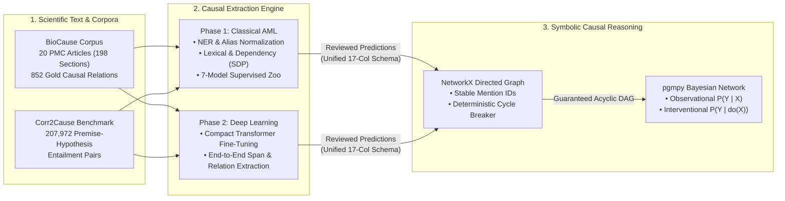

# Neuro-Symbolic Causal NLP Reasoning

**Extracting Cause-and-Effect Relations from Scientific Text into Directed Acyclic Graphs (DAGs) and Causal Bayesian Networks**

This project builds a hybrid neuro-symbolic system that extracts directed causal relations from biomedical literature (**BioCause**), enforces topological DAG constraints in **NetworkX**, and answers formal interventional queries ($P(Y \mid do(X))$) using **Pearl's $do$-calculus in `pgmpy`**, alongside abstract causal discovery benchmarks (**Corr2Cause**).

---

## System Architecture Overview



---

## Visual Highlights (Phase 1 — Applied Machine Learning)

### 1. Multi-Pathway Relation Extraction Benchmark
Comparing deterministic lexical patterns, syntactic dependency trees, and validation-selected supervised classifiers (`Logistic Regression`, `HistGBT`, `Random Forest`) on held-out test publications:


### 2. Text-to-DAG Transformation & Deterministic Cycle Enforcement
Natural language extractors can propose conflicting or cyclic edges. Our graph compiler (`enforce_dag_acyclicity`) automatically prunes self-loops, bidirectional conflicts, and minimum-confidence feedback edges so downstream Bayesian networks are guaranteed acyclic:


---

## At-a-Glance Phase 1 Results (Held-Out Test Split)

| Pipeline Stage | Best Method / Configuration | Key Held-Out Test Metric | Detailed Documentation |
| :--- | :--- | :--- | :--- |
| **Data & Split Hygiene** | 12 Train / 4 Val / 4 Test PMC Articles | **100% Offset Validity**, **0 Cross-Article Leaks** | [`00_setup.ipynb`](00_setup.ipynb), [`01_eda.ipynb`](01_eda.ipynb) |
| **Rule & Dependency Extraction** | Hybrid Lexical + spaCy Dependency + SDP | **40.74% F1** (37.93% P, **44.00% R**) | [`AML/AML_03_dependency_patterns.ipynb`](AML/AML_03_dependency_patterns.ipynb) |
| **Supervised Classifier (F1-Optimal)** | `Logistic Regression (Moderate Weight 1:2)` | **55.32% F1** (59.09% P, **52.00% R**, **0.7606 Macro-F1**) | [`AML/AML_04_classical_classifier.ipynb`](AML/AML_04_classical_classifier.ipynb) |
| **Supervised Classifier (High-Precision DAG)** | `Logistic Regression (Unweighted)` | **45.33% F1** (**68.00% P**, 34.00% R, **94.18% Acc**) | [`AML/AML_04_classical_classifier.ipynb`](AML/AML_04_classical_classifier.ipynb) |
| **DAG Edge Evaluation** | Stable-ID NetworkX Graph (`PMC2714965` / Corpus) | **100.00% Case Study Edge P** / **68.00% Corpus Edge P** | [`AML/AML_04_classical_classifier.ipynb`](AML/AML_04_classical_classifier.ipynb) |
| **Bayesian Network Reasoning** | `pgmpy` `DiscreteBayesianNetwork` + `do()` | $P(\text{Res}\mid \text{PmrB}{=}1){=}\mathbf{0.66}$ vs. $P(\text{Res}\mid do(\text{PmrA}{=}1)){=}\mathbf{0.85}$ | [`AML/AML_05_integration_evaluation.ipynb`](AML/AML_05_integration_evaluation.ipynb) |

> **Dive Deeper into Phase 1**: See [**`AML/README.md`**](AML/README.md) for the full literature review table, 7-model validation comparisons, `GroupKFold` tuning curves, 95% bootstrap confidence intervals, learned feature importances, and notebook-by-notebook breakdowns.

---

## Repository Navigation

```text
causal-nlp-reasoning/
├── README.md                           # High-level visual overview & quickstart (this file)
├── 00_setup.ipynb                      # Automated dataset acquisition, SHA/offset validation & staging
├── 01_eda.ipynb                        # Shared Exploratory Data Analysis & shortcut diagnostics
├── AML/                                # Phase 1: Applied Machine Learning Pipeline
│   ├── README.md                       # Detailed Phase 1 technical documentation, tables & plots
│   ├── assets/                         # Exported visual plots tracked for documentation
│   ├── causal_extractors.py            # Shared lexical, dependency (SDP) & cycle-breaking module
│   ├── AML_01_data_features.ipynb      # Standoff parser, 12/4/4 group split & candidate generation
│   ├── AML_02_ner.ipynb                # Alias normalization & 3-regime spaCy NER evaluation
│   ├── AML_03_dependency_patterns.ipynb# Directional rules, dependency trees & SDP verification
│   ├── AML_04_classical_classifier.ipynb# 7-model zoo, GroupKFold, PR curves, DAGs & pgmpy do-calculus
│   └── AML_05_integration_evaluation.ipynb# End-to-end 3-pathway benchmark & acceptance gate
├── DL/                                 # Phase 2: Deep Learning & Transformer Pipeline
│   └── DL_01 .. DL_05.ipynb            # Transformer fine-tuning & neuro-symbolic integration
├── tests/
│   └── test_phase1_baseline.py         # 16 automated unit, corpus, metric & notebook verification tests
├── requirements.txt                    # Phase 1 dependencies
└── requirements-dl.txt                 # Phase 2 deep learning dependencies
```

---

## Quickstart & Verification

```bash
# 1. Activate virtual environment & install Phase 1 dependencies
source .venv/bin/activate
pip install -r requirements.txt
python -m spacy download en_core_web_sm

# 2. Run the 16-test automated Phase 1 verification suite
python tests/test_phase1_baseline.py
```

All 7 Phase 1 notebooks (`00_setup.ipynb`, `01_eda.ipynb`, and `AML/AML_01` through `AML/AML_05`) are pre-executed with **100% (`85/85`) visible cell outputs and inline plots** saved directly inside the `.ipynb` files.
