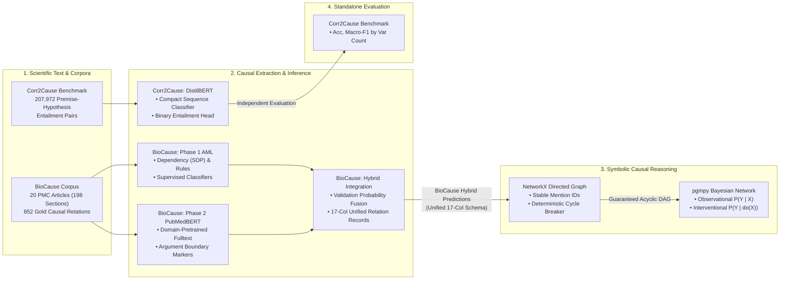
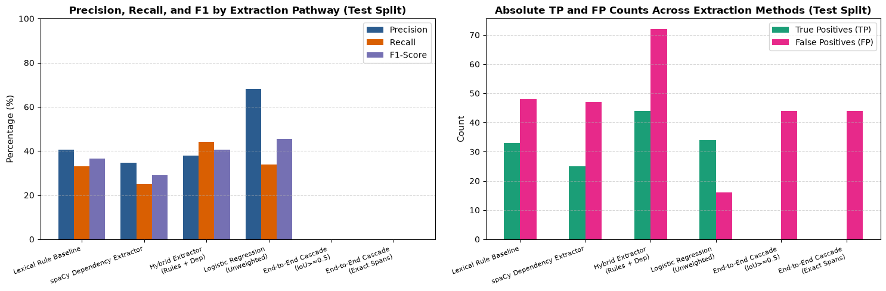
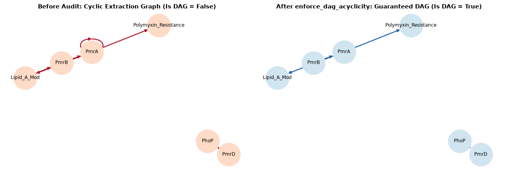
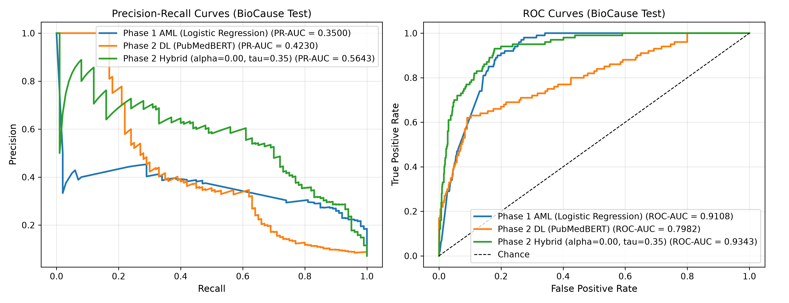

# Neuro-Symbolic Causal NLP Reasoning

**Extracting Cause-and-Effect Relations from Scientific Text into Directed Acyclic Graphs (DAGs) and Causal Bayesian Networks**

This project builds a hybrid neuro-symbolic system that extracts directed causal relations from biomedical literature (**BioCause**), enforces topological DAG constraints in **NetworkX**, and answers formal interventional queries ($P(Y \mid do(X))$) using **Pearl's $do$-calculus in `pgmpy`**, alongside abstract causal discovery benchmarks (**Corr2Cause**).

---

## System Architecture Overview



---

## Visual Highlights (Phase 1 — Applied Machine Learning)

### 1. Multi-Pathway Relation Extraction Benchmark
Comparing deterministic lexical patterns, syntactic dependency trees, and validation-selected supervised classifiers (`Logistic Regression`, `HistGBT`, `Random Forest`) on held-out test publications:



### 2. Text-to-DAG Transformation & Deterministic Cycle Enforcement
Natural language extractors can propose conflicting or cyclic edges. Our graph compiler (`enforce_dag_acyclicity`) automatically prunes self-loops, bidirectional conflicts, and minimum-confidence feedback edges so downstream Bayesian networks are guaranteed acyclic:



---

## At-a-Glance Phase 1 Results (Held-Out Test Split)

| Pipeline Stage | Best Method / Configuration | Key Held-Out Test Metric | Detailed Documentation |
| :--- | :--- | :--- | :--- |
| **Data & Split Hygiene** | 12 Train / 4 Val / 4 Test PMC Articles | **100% Offset Validity**, **0 Cross-Article Leaks** | [`00_setup.ipynb`](00_setup.ipynb), [`01_eda.ipynb`](01_eda.ipynb) |
| **Rule & Dependency Extraction** | Hybrid Lexical + spaCy Dependency + SDP | **40.74% F1** (37.93% P, **44.00% R**) | [`AML/AML_03_dependency_patterns.ipynb`](AML/AML_03_dependency_patterns.ipynb) |
| **Supervised Classifier (F1-Optimal)** | `Logistic Regression (Moderate Weight 1:2)` | **55.32% F1** (59.09% P, **52.00% R**, **0.7606 Macro-F1**) | [`AML/AML_04_classical_classifier.ipynb`](AML/AML_04_classical_classifier.ipynb) |
| **Supervised Classifier (High-Precision DAG)** | `Logistic Regression (Unweighted)` | **45.33% F1** (**68.00% P**, 34.00% R, **94.18% Acc**) | [`AML/AML_04_classical_classifier.ipynb`](AML/AML_04_classical_classifier.ipynb) |
| **DAG Edge Evaluation** | Stable-ID NetworkX Graph (`PMC2714965` / Corpus) | **100.00% Case Study Edge P** / **68.00% Corpus Edge P** | [`AML/AML_04_classical_classifier.ipynb`](AML/AML_04_classical_classifier.ipynb) |
| **Bayesian Network Reasoning** | `pgmpy` `DiscreteBayesianNetwork` + `do()` | $P(\text{Res}\mid \text{PmrB}{=}1){=}\mathbf{0.66}$ vs. $P(\text{Res}\mid do(\text{PmrA}{=}1)){=}\mathbf{0.85}$ | [`AML/AML_05_integration_evaluation.ipynb`](AML/AML_05_integration_evaluation.ipynb) |

> **Dive Deeper into Phase 1**: See [**`AML/README.md`**](AML/README.md) for the full literature review table, 7-model validation comparisons, `GroupKFold` tuning curves, 95% bootstrap confidence intervals, learned feature importances, and notebook-by-notebook breakdowns.

---

## Phase 2 — Deep Learning & Hybrid Neuro-Symbolic Integration

Phase 2 fine-tunes two isolated transformer streams alongside the Phase 1 AML classifier and fuses biomedical causal predictions into an acyclic DAG and causal Bayesian interface. See [**`DL/README.md`**](DL/README.md) and the [**Final DL Execution Audit Report**](reports/DL_FINAL_EXECUTION_AUDIT.md) for full methodology and audit details.

### Architecture & Sequential Execution Order
Execute the five Phase 2 notebooks sequentially (GPU runtime recommended for `DL_02`, `DL_03`, and `DL_05`):
1. [`DL/DL_01_data_preparation.ipynb`](DL/DL_01_data_preparation.ipynb) — Audit strict 12/4/4 BioCause article splits (`9,928` train / `1,884` val / `1,394` test model-eligible; `10,086` / `1,914` / `1,408` raw), inject `[E1]...[/E1]` and `[E2]...[/E2]` entity markers, and profile `MAX_LENGTH = 384`.
2. [`DL/DL_02_corr2cause_distilbert.ipynb`](DL/DL_02_corr2cause_distilbert.ipynb) — Fine-tune `distilbert-base-uncased` on the independent **Corr2Cause** entailment split (`205,734` train / `1,076` val / `1,162` test; `MAX_LENGTH = 256`). *(Strictly isolated: never feeds the BioCause graph.)*
3. [`DL/DL_03_biocause_pubmedbert.ipynb`](DL/DL_03_biocause_pubmedbert.ipynb) — Fine-tune `microsoft/BiomedNLP-BiomedBERT-base-uncased-abstract-fulltext` with normalized dynamic class weighting ($w_{\text{pos}} = 9,307 / 621 \approx 14.9871$), perform joint validation `(epoch, threshold)` selection (`checkpoint-3723`, Epoch `3.0`, $\tau^* = 0.1600$), evaluate held-out test, and persist SafeTensors weights & tokenizer (Sections 9–10).
4. [`DL/DL_04_hybrid_graph_integration.ipynb`](DL/DL_04_hybrid_graph_integration.ipynb) — Fuse validation probabilities ($P_{\text{hybrid}} = \alpha P_{\text{DL}} + (1 - \alpha) P_{\text{AML}}$) selecting $\alpha^* = 0.25, \tau^* = 0.4400$ strictly on validation, evaluate frozen test predictions, apply negation filtering + `enforce_dag_acyclicity`, compile structural DAG, and package `DL/models/hybrid_biocause/` including Joblib `aml_classifier.pkl` (Sections 11–12).
5. [`DL/DL_05_evaluation_ablation.ipynb`](DL/DL_05_evaluation_ablation.ipynb) — Run consolidated Corr2Cause/BioCause benchmarks, 4-dimensional ablations (entity markers, class weighting, ensembling, linguistic pruning), DAG edge evaluation, illustrative do-calculus motif, and master CSV/figure exports to `reports/`.

### Phase 2 Visual Highlights & Artifacts
- **Precision-Recall & ROC Curves**: [`reports/dl_biocause_pr_roc_curves.png`](reports/dl_biocause_pr_roc_curves.png)
- **Model Paradigm Comparison (F1 & TP/FP)**: [`reports/dl_biocause_model_comparison.png`](reports/dl_biocause_model_comparison.png)
- **Held-Out Test Confusion Matrices**: [`reports/dl_biocause_confusion_matrices.png`](reports/dl_biocause_confusion_matrices.png)
- **Illustrative Bayesian DAG Motif**: [`reports/dl_biocause_bayesian_dag_motif.png`](reports/dl_biocause_bayesian_dag_motif.png)
- **Master Benchmark CSV**: [`reports/dl_final_benchmark_summary.csv`](reports/dl_final_benchmark_summary.csv)
- **Systematic Ablation CSV**: [`reports/dl_ablation_summary.csv`](reports/dl_ablation_summary.csv)



### At-a-Glance Phase 2 Results (Held-Out Test Splits)

#### Why Hybrid Fusion Was Selected (AML Baseline $\to$ PubMedBERT $\to$ Hybrid Fusion)
1. **Phase 1 AML Baseline (`Logistic Regression (Moderate Weight 1:2)`)**: Structural, lexical, and TF-IDF features provide strong precision and ranking (`ROC-AUC = 0.9431`, `PR-AUC = 0.6119`), achieving `Pos F1 = 0.5622` (`Pos Precision = 0.6118`, `Pos Recall = 0.5200`) at fixed `0.5000` and `Pos F1 = 0.5568` (`Pos Precision = 0.6447`, `Pos Recall = 0.4900`) at validation-selected `0.5200` (`Val Pos F1 = 0.5976`).
2. **Phase 2 PubMedBERT (`checkpoint-3723`, Epoch `3.0`, $\tau^* = 0.1600$)**: Fine-tuned transformer representations capture broader contextual patterns and achieve the highest positive recall (`0.5800` test, `TP=58`), but dynamic class weighting (`9307 / 621 = 14.9871`) produces more false positives (`FP=98`), lowering standalone `Pos Precision` (`0.3718`), `Pos F1` (`0.4531`), and `PR-AUC` (`0.3744`).
3. **Hybrid Fusion ($\alpha^* = 0.25$, $\tau^* = 0.4400$)**: Validation-only grid search selected $P_{\text{hybrid}} = 0.25 P_{\text{DL}} + 0.75 P_{\text{AML}}$ because combining PubMedBERT's contextual signal with AML's precision raised validation `Pos F1` to **`0.6383`** (`Val Macro-F1 = 0.8071`, `+0.0407` over tuned AML). On the held-out test split, the frozen hybrid achieves the **highest ranking metrics overall** (**`ROC-AUC = 0.9478`**, **`PR-AUC = 0.6269`**) while cutting PubMedBERT's false positives by `69%` (`98 -> 30`, `Pos F1 = 0.5475`, `Macro-F1 = 0.7582`). Selection is strictly validation-driven without claiming statistical significance.

#### BioCause Candidate-Level Benchmark ($N = 1,394$ Model-Eligible Candidates, $100$ Positives)
| Model Paradigm | Threshold | TP | FP | FN | TN | Accuracy | Pos Precision | Pos Recall | Pos F1 | Macro-F1 | ROC-AUC | PR-AUC |
| :--- | :---: | :---: | :---: | :---: | :---: | :---: | :---: | :---: | :---: | :---: | :---: | :---: |
| `Lexical baseline` | `-` | 7 | 339 | 93 | 955 | 0.6901 | 0.0202 | 0.0700 | 0.0314 | 0.4235 | `-` | `-` |
| `AML (fixed 0.50)` | `0.5000` | 52 | 33 | 48 | 1261 | 0.9419 | 0.6118 | 0.5200 | **0.5622** | **0.7655** | 0.9431 | 0.6119 |
| `AML-only (validation-selected)` | `0.5200` | 49 | 27 | 51 | 1267 | **0.9440** | **0.6447** | 0.4900 | 0.5568 | 0.7635 | 0.9431 | 0.6119 |
| `PubMedBERT (checkpoint-3723, Epoch 3.0)` | `0.1600` | 58 | 98 | 42 | 1196 | 0.8996 | 0.3718 | **0.5800** | 0.4531 | 0.6989 | 0.8950 | 0.3744 |
| `Validation-selected hybrid` ($\alpha^*=0.25$) | `0.4400` | 49 | 30 | 51 | 1264 | 0.9419 | 0.6203 | 0.4900 | 0.5475 | 0.7582 | **0.9478** | **0.6269** |
| `Sanitized hybrid` (negation pruned) | `0.4400` | 46 | 27 | 54 | 1267 | 0.9419 | 0.6301 | 0.4600 | 0.5318 | 0.7504 | **0.9478** | **0.6269** |

#### Summary of Ablations, Corr2Cause & DAG Graph Evaluation
- **Corr2Cause (`DistilBERT`, $N = 1,162$ test)**: `Accuracy = 0.8623`, `Pos F1 = 0.4366` (`Pos P = 0.5962`, `Pos R = 0.3444`), `Macro-F1 = 0.6791`, `ROC-AUC = 0.8594`, `PR-AUC = 0.5135`.
- **Ablation Findings ([`reports/dl_ablation_summary.csv`](reports/dl_ablation_summary.csv))**:
  - Removing entity markers (`[E1]`, `[E2]`) drops PubMedBERT test Pos F1 from `0.4531` (`checkpoint-3723`, Epoch `3.0`) to `0.2970` (`checkpoint-2482`, Epoch `2.0`, `ROC-AUC: 0.8950 -> 0.7980`).
  - Unweighted cross-entropy collapses at default `0.50` `argmax` (`0` positives across all epochs); with joint validation epoch and threshold selection (`checkpoint-3723`, Epoch `3.0`, $\tau^* = 0.0800$), unweighted CE yields `Pos F1 = 0.4508` (`Pos P = 0.3819`, `Pos R = 0.5500`, `PR-AUC = 0.3743`), while dynamic weighting ($w_{\text{pos}} = 14.9871$) increases positive recall (`0.5800`) and `Pos F1` (`0.4531`).
- **Empirical DAG Structure vs. Illustrative Synthetic CPDs**:
  - **Empirical Extracted DAG (`enforce_dag_acyclicity`)**: Out of `100` gold test edges, pre-pruning extracted `73` edges (`TP=46, FP=27, Precision=0.6301, Recall=0.4600, F1=0.5318, Is DAG=False`); deterministic cycle breaking removed `4` strictly false-positive bidirectional conflicts, yielding a verified acyclic DAG of `69` edges (`TP=46, FP=23, Precision=0.6667, Recall=0.4600, F1=0.5444, Is DAG=True`).
  - **Illustrative Bayesian Network Demonstration**: `DL_04` (Section 8) and `DL_05` (Section 7) compile small synthetic-CPD motifs in `pgmpy.models.DiscreteBayesianNetwork` (`Sensor -> Regulator -> Resistance`: baseline `0.4242` vs. observational `0.7200` vs. `do(Regulator=1) = 0.8500`) solely to demonstrate Pearl's $do$-calculus separately from empirical corpus counts.

### Deployable Hybrid BioCause Package (`DL/models/hybrid_biocause/`)
Packaging metadata, verified model binaries, and reusable inference code live in [`DL/models/hybrid_biocause/`](DL/models/hybrid_biocause/), [`DL/hybrid_inference.py`](DL/hybrid_inference.py), and [`DL/HYBRID_MODEL_PACKAGE.md`](DL/HYBRID_MODEL_PACKAGE.md):
- `pubmedbert/` — PubMedBERT model (`model.safetensors`, `417.68 MB`; `config.json`; `checkpoint_provenance.json`) + marker tokenizer (`tokenizer.json`, `tokenizer_config.json`), never pickled.
- `aml_classifier.pkl` — Joblib-serialized sklearn `Pipeline` (`6,708` bytes; `BioCauseAMLFeatureExtractor` + `LogisticRegression(class_weight={0: 1.0, 1: 2.0})`).
- `fusion_config.json` & `model_manifest.json` — Frozen validation parameters (`alpha_star = 0.25`, `threshold_star = 0.44`), feature specs, split counts, AML equivalence checks (`val_max_abs_diff = 1.11e-16`, `test_max_abs_diff = 1.00e-16`), and verified persistence status (`reload_and_inference_verified: true`).

> [!NOTE] Binary Persistence & Security Policy
> `.gitignore` is configured to **track** `DL/models/hybrid_biocause/` (including `model.safetensors` and `aml_classifier.pkl`) while keeping training `checkpoints/`, `*.pt`, `*.pth`, and `*.bin` ignored. `.gitattributes` already tracks `DL/models/hybrid_biocause/pubmedbert/model.safetensors` (`417.68 MB`) via **Git LFS** (ensure `git-lfs` is installed when cloning/pulling). Load `aml_classifier.pkl` only from trusted, verified project outputs because Joblib/pickle deserialization can execute arbitrary code.

```python
import joblib
from transformers import AutoModelForSequenceClassification, AutoTokenizer
from DL.hybrid_inference import HybridBioCausePredictor

# Option A: Unified inference wrapper (AML + PubMedBERT + frozen fusion + linguistic filter + DAG)
predictor = HybridBioCausePredictor("DL/models/hybrid_biocause")
preds_df = predictor.predict_candidates(biocause_candidates_df)

# Option B: Direct component loading (trusted source only; ensure DL/ is on sys.path for aml_classifier.pkl)
aml_pipeline = joblib.load("DL/models/hybrid_biocause/aml_classifier.pkl")
tokenizer = AutoTokenizer.from_pretrained("DL/models/hybrid_biocause/pubmedbert", local_files_only=True)
model = AutoModelForSequenceClassification.from_pretrained("DL/models/hybrid_biocause/pubmedbert", local_files_only=True)
```

---

## Repository Navigation

```text
causal-nlp-reasoning/
├── README.md                           # High-level visual overview & quickstart (this file)
├── 00_setup.ipynb                      # Automated dataset acquisition, SHA/offset validation & staging
├── 01_eda.ipynb                        # Shared Exploratory Data Analysis & shortcut diagnostics
├── AML/                                # Phase 1: Applied Machine Learning Pipeline
│   ├── README.md                       # Detailed Phase 1 technical documentation, tables & plots
│   ├── assets/                         # Exported visual plots tracked for documentation
│   ├── causal_extractors.py            # Shared lexical, dependency (SDP) & cycle-breaking module
│   ├── AML_01_data_features.ipynb      # Standoff parser, 12/4/4 group split & candidate generation
│   ├── AML_02_ner.ipynb                # Alias normalization & 3-regime spaCy NER evaluation
│   ├── AML_03_dependency_patterns.ipynb# Directional rules, dependency trees & SDP verification
│   ├── AML_04_classical_classifier.ipynb# 7-model zoo, GroupKFold, PR curves, DAGs & pgmpy do-calculus
│   └── AML_05_integration_evaluation.ipynb# End-to-end 3-pathway benchmark & acceptance gate
├── DL/                                 # Phase 2: Deep Learning & Transformer Pipeline
│   ├── README.md                       # Phase 2 architecture, contracts, execution & technical scope
│   ├── HYBRID_MODEL_PACKAGE.md         # Tracked hybrid model packaging, loading & schema guide
│   ├── dl_utils.py                     # Shared utilities, schemas, seed, device & evaluation helpers
│   ├── hybrid_inference.py             # Reusable AML feature pipeline, packaging & hybrid inference API
│   ├── DL_01_data_preparation.ipynb    # Data schemas, 12/4/4 split audit & entity boundary markers
│   ├── DL_02_corr2cause_distilbert.ipynb # DistilBERT fine-tuning for NLI causal entailment
│   ├── DL_03_biocause_pubmedbert.ipynb # PubMedBERT fine-tuning, joint selection & SafeTensors persistence
│   ├── DL_04_hybrid_graph_integration.ipynb # Validation fusion, DAG reasoning, .pkl & bundle packaging
│   ├── DL_05_evaluation_ablation.ipynb # Comparative evaluation, ablation studies & final reporting
│   └── models/hybrid_biocause/         # Packaged hybrid deployment config, manifest & target model dir
├── reports/                            # Benchmark CSVs, ablation CSV, PR/ROC & DAG figures, audit report
│   ├── DL_FINAL_EXECUTION_AUDIT.md     # Reconciled Phase 2 execution & persistence audit report
│   ├── dl_final_benchmark_summary.csv  # BioCause candidate-level benchmark comparison
│   ├── dl_ablation_summary.csv         # 7-row executed ablation study summary
│   ├── dl_biocause_pr_roc_curves.png   # Comparative PR & ROC curve plot
│   └── dl_biocause_bayesian_dag_motif.png # Illustrative 3-node Bayesian do-calculus diagram
├── tests/
│   └── test_phase1_baseline.py         # 16 automated unit, corpus, metric & notebook verification tests
├── requirements.txt                    # Phase 1 dependencies
└── requirements-dl.txt                 # Phase 2 deep learning dependencies
```

---

## Quickstart & Verification

```bash
# 1. Activate virtual environment & install Phase 1 dependencies
source .venv/bin/activate
pip install -r requirements.txt
python -m spacy download en_core_web_sm

# 2. Install Phase 2 deep learning dependencies (Colab/GPU recommended; keep pre-installed CUDA torch)
pip install -r requirements-dl.txt

# 3. Run the 16-test automated Phase 1 verification suite
python tests/test_phase1_baseline.py
```

All 7 Phase 1 notebooks (`00_setup.ipynb`, `01_eda.ipynb`, and `AML/AML_01` through `AML/AML_05`) are pre-executed with **100% (`85/85`) visible cell outputs and inline plots** saved directly inside the `.ipynb` files. Phase 2 notebooks (`DL_01` through `DL_05`) were executed sequentially in Google Colab with results reconciled in [`reports/DL_FINAL_EXECUTION_AUDIT.md`](reports/DL_FINAL_EXECUTION_AUDIT.md); follow [`DL/HYBRID_MODEL_PACKAGE.md`](DL/HYBRID_MODEL_PACKAGE.md) to verify final model weight persistence (`model.safetensors`) and Joblib `.pkl` packaging in Colab.
